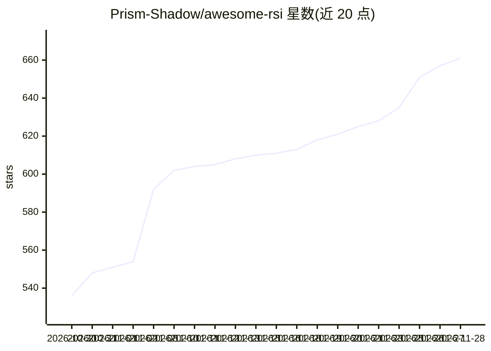

# Prism-Shadow/awesome-rsi

⭐ 661 · JavaScript · 推送 2026-11-27 · [GitHub](https://github.com/Prism-Shadow/awesome-rsi) · [官网](https://prism-shadow.github.io/awesome-rsi/) · 组织维护 · 中文 README

**递归自我改进（RSI）论文索引，含152篇方法与34个基准**

收录递归自我改进领域的论文与项目清单：按 RSI artifact 维度组织方法与系统（模型参数、Harness 代码、上下文、记忆、技能等类别），按 RSI mode 维度组织基准，共收录 152 篇方法论文、34 篇基准论文与 3 个系统。附自述调研报告提出九维分类法，配套网站支持按多维过滤、引文图浏览，并提供中英文图文入门指南与视频导览。README 不含安装与运行说明，仅以链接与表格形式呈现条目。

## 筛选速览

| 维度 | 判定 | 备注 |
|---|---|---|
| AI 角色 | `ai-knowledge` | 知识聚合/清单类 |
| 许可风险 | `none` | — |
| 部署形态 | `None` |  |
| 模型依赖 | — | README 未给出锁定关系 |
| 硬件要求 | — | 无带数字的原话,不猜 |
| 安装摩擦 | `low` | 无编译、无系统依赖或容器化 |
| 成熟度 | — | 结构信号不足 |

## 能力要点

- 152 篇方法论文、34 篇基准论文、3 个系统
- 按 RSI artifact 维度分组的论文树与清单
- 配套网站支持多维过滤与引文图
- 中英文图文入门指南与 1 分钟视频导览

## 适用场景

- 查找可基于其开展研究的 RSI 方法论文
- 对比不同 RSI 基准的评测协议
- 通过引文图梳理 RSI 领域论文间关系

## 场景标签

`精选清单` · 领域:学习与行业

## 证据(README 行号)

> L29: Awesome RSI collects **benchmarks, methods, and systems for Recursive Self-Improvement**. We follow the loop: an ag
> L31: **152 method papers · 34 benchmark papers · 3 systems**
> L42: Each list in this README is organized along **one dimension**: **RSI artifact** for methods and systems, and **RSI 

## 星数曲线

2026-10-30 536 → 2026-11-28 661（+125）

---
*卡片 v1 · prompt 1.4 · 生成 2026-11-28 · 置信度 high · 依据 README sha `5bec73d1f516` · [字段定义](../../DATASET.md)*
