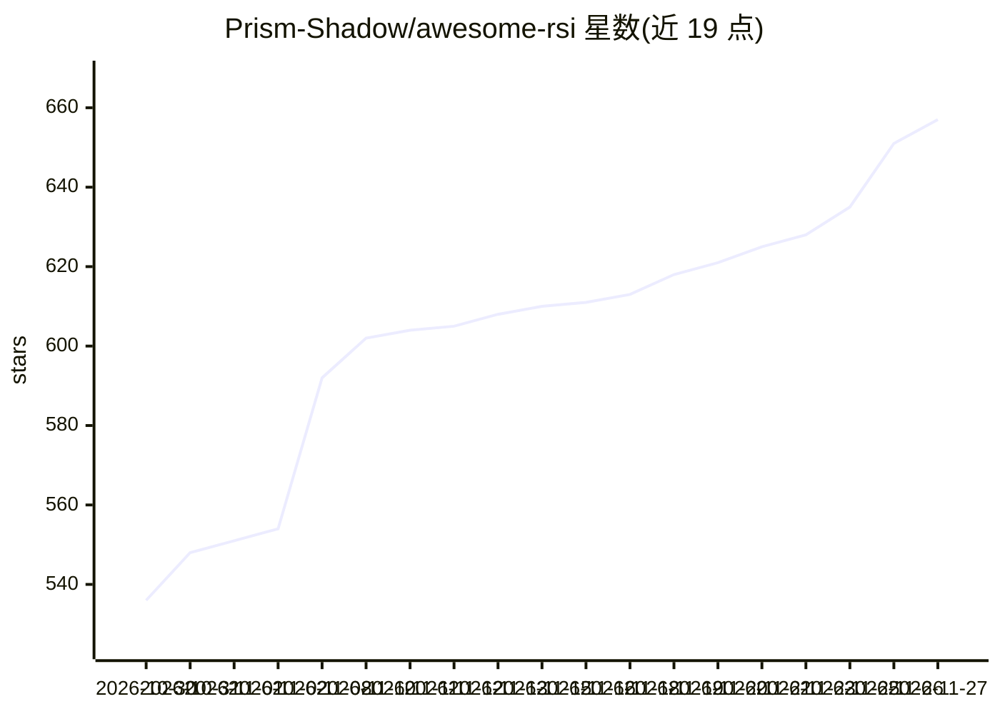

# Prism-Shadow/awesome-rsi

⭐ 657 · JavaScript · 推送 2026-11-26 · [GitHub](https://github.com/Prism-Shadow/awesome-rsi) · [官网](https://prism-shadow.github.io/awesome-rsi/) · 个人维护 · 中文 README

**递归自我改进（RSI）论文策展索引：收集方法、基准与系统**

以清单形式收集递归自我改进领域的论文与项目，共 150 篇方法论文、34 篇基准论文与 3 个系统。按 RSI artifact（模型参数、Harness 代码、上下文、记忆、技能等）组织方法列表，按 RSI mode 组织基准列表，另附九维分类法综述、图示入门指南（英文与中文）、引用图谱与配套网站，支持按维度过滤比较。README 本身不含安装或运行内容，为纯文献导航资源。

## 筛选速览

| 维度 | 判定 | 备注 |
|---|---|---|
| AI 角色 | `ai-knowledge` | 知识聚合/清单类 |
| 许可风险 | `none` | — |
| 部署形态 | `None` |  |
| 模型依赖 | — | README 未给出锁定关系 |
| 硬件要求 | — | 无带数字的原话,不猜 |
| 安装摩擦 | `low` | 无编译、无系统依赖或容器化 |
| 成熟度 | — | 结构信号不足 |

## 能力要点

- 收录 150 篇方法论文、34 篇基准论文、3 个系统
- 按 RSI artifact 维度（模型参数/Harness 代码/上下文/记忆/技能）组织方法列表
- 提供九维分类法综述与引用图谱
- 配套网站支持多维度组合过滤

## 适用场景

- 为自我改进 agent 方向的论文调研寻找起点
- 按改进对象（参数/代码/上下文等）筛选相关工作
- 通过引用图谱梳理方法与基准之间的关联

## 场景标签

`科研工具` `精选清单` · 领域:学习与行业

## 证据(README 行号)

> L29: Awesome RSI collects **benchmarks, methods, and systems for Recursive Self-Improvement**. We follow the loop: an ag
> L31: **150 method papers · 34 benchmark papers · 3 systems**
> L42: Each list in this README is organized along **one dimension**: **RSI artifact** for methods and systems, and **RSI 

## 星数曲线

2026-10-30 536 → 2026-11-27 657（+121）

---
*卡片 v1 · prompt 1.4 · 生成 2026-11-27 · 置信度 high · 依据 README sha `37c20c3071c0` · [字段定义](../../DATASET.md)*
