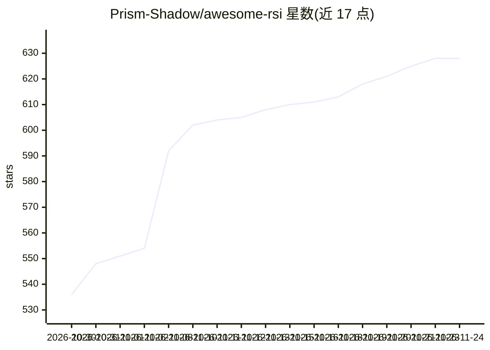

# Prism-Shadow/awesome-rsi

⭐ 628 · JavaScript · 推送 2026-11-22 · [GitHub](https://github.com/Prism-Shadow/awesome-rsi) · [官网](https://prism-shadow.github.io/awesome-rsi/) · 组织维护 · 中文 README

**递归自我改进（RSI）论文与基准索引，供研究者检索**

一份收录递归自我改进（Recursive Self-Improvement）领域文献的清单仓库，共整理 144 篇方法论文、34 篇基准论文与 3 个系统。按 RSI artifact（模型参数、Harness 代码、上下文、记忆、技能等）与 RSI mode 两个维度组织列表，配套九维分类法综述、论文树状图与引用图谱，并提供可按多维度筛选的配套网站。中英文插图式入门指南与视频讲解亦包含在内。

## 筛选速览

| 维度 | 判定 | 备注 |
|---|---|---|
| AI 角色 | `ai-knowledge` | 知识聚合/清单类 |
| 许可风险 | `none` | — |
| 部署形态 | `None` |  |
| 模型依赖 | — | README 未给出锁定关系 |
| 硬件要求 | — | 无带数字的原话,不猜 |
| 安装摩擦 | `low` | 无编译、无系统依赖或容器化 |
| 成熟度 | — | 结构信号不足 |

## 能力要点

- 144 篇方法论文、34 篇基准论文、3 个系统的结构化收录
- 按 RSI artifact（参数/Harness/上下文/记忆/技能）维度组织
- 配套网站支持多维度比较与组合筛选
- 附九维分类法综述与中英文插图式入门指南

## 适用场景

- 为 RSI 研究寻找可借鉴的方法论文
- 按 artifact 或反馈机制筛选相关基准
- 通过引用图谱梳理论文间关联

## 场景标签

`科研工具` `精选清单` · 领域:学习与行业

## 证据(README 行号)

> L29: Awesome RSI collects **benchmarks, methods, and systems for Recursive Self-Improvement**. We follow the loop: an ag
> L31: **144 method papers · 34 benchmark papers · 3 systems**

## 星数曲线

2026-10-30 536 → 2026-11-24 628（+92）

---
*卡片 v1 · prompt 1.4 · 生成 2026-11-24 · 置信度 high · 依据 README sha `0bd9eab49bbb` · [字段定义](../../DATASET.md)*
