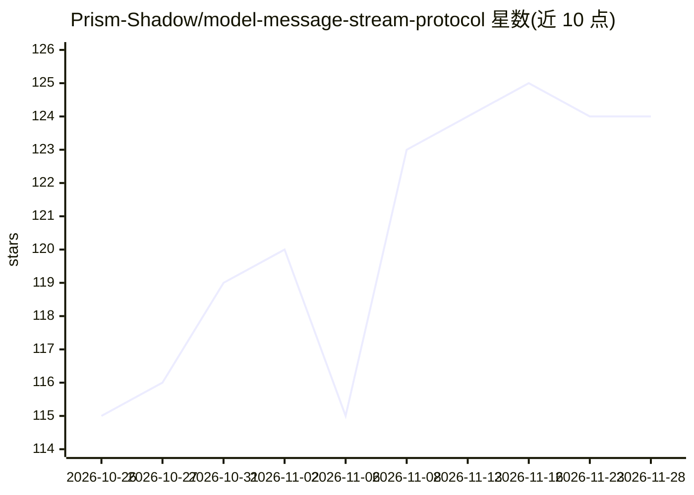

# Prism-Shadow/model-message-stream-protocol

⭐ 124 · TypeScript · Apache-2.0 · 推送 2026-11-27 · [GitHub](https://github.com/Prism-Shadow/model-message-stream-protocol) · [官网](https://mmsp.penguin.ooo/) · 组织维护 · 中文 README

**为开发者统一 1000+ LLM 接入接口的 SDK，零代码切换并内置追踪**

MMSP 是 Python 与 TypeScript 双语言的 LLM 接入 SDK，核心类 AutoLLMClient 通过统一消息格式（UniMessage）与流式事件语法（UniEvent）屏蔽各厂商 API 差异，切换模型只需改模型 id。提供官方客户端（读取各厂商环境变量密钥）与通用协议客户端（OpenAI Chat/Responses、Anthropic Messages 等）两类 client_type，内置模型注册表可查询变体、供应商与价格（支持 USD/CNY）。通过单一 trace_id 参数提供执行追踪；流式输出以 delta 事件加唯一 stop 事件（携带 usage 与 finish_reason）组织，token 用量拆分为缓存、提示、思考、回答四项。0.5.0 前的消息类型将在 0.6.0 后停止接受。

## 筛选速览

| 维度 | 判定 | 备注 |
|---|---|---|
| AI 角色 | `ai-ecosystem` | LLM/agent 周边工具 |
| 许可风险 | `permissive` | Apache-2.0 |
| 部署形态 | `library` | 以包/库形式分发 |
| 模型依赖 | local-ok | 支持本地模型 |
| 硬件要求 | — | 无带数字的原话,不猜 |
| 安装摩擦 | `medium` | 含编译或系统依赖之一 |
| 成熟度 | — | 结构信号不足 |

## 能力要点

- AutoLLMClient 零代码修改切换不同 LLM，覆盖 12 个模型家族及自定义兼容端点
- 内置模型注册表，可列出所有变体、供应商与定价（USD/CNY）
- trace_id 参数即得 LLM 执行追踪，无需数据库
- 流式协议：delta 事件 + 携带 usage/finish_reason 的 stop 事件，token 用量四项细分

## 适用场景

- 跨多个 LLM 供应商开发 agent，统一接口减少学习成本
- 多步工具调用中自动处理交错思考，避免性能退化
- 调试与审计 LLM 执行过程时按 trace_id 追踪
- 通过通用协议客户端接入任意 OpenAI/Anthropic 兼容端点

## 场景标签

`模型网关` · 领域:Agent 开发

## 证据(README 行号)

> L16: MMSP, the Model Message Stream Protocol, takes the per-provider differences off a developer's mind: one message for
> L38: Switch different LLMs with **zero code changes** and **no performance loss**.
> L82: |`openai-chat` (`openai`)|OpenAI Chat Completions (most gateways, SiliconFlow, vLLM)|`OPENAI_API_KEY`, `OPENAI_BASE

## 星数曲线

2026-10-26 115 → 2026-11-28 124（+9）

---
*卡片 v1 · prompt 1.4 · 生成 2026-11-28 · 置信度 high · 依据 README sha `0c3f09fe4bbb` · [字段定义](../../DATASET.md)*
