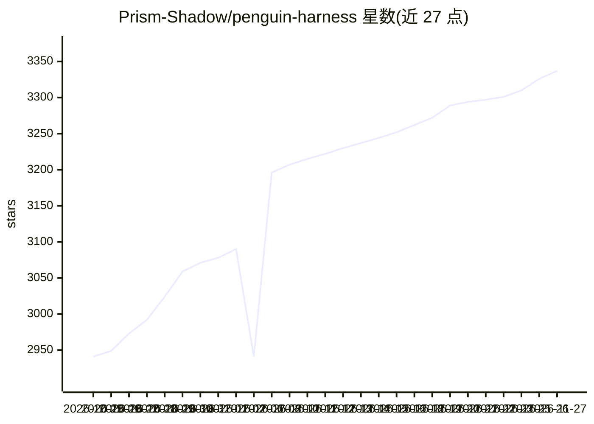

# Prism-Shadow/penguin-harness

⭐ 3,337 · TypeScript · Apache-2.0 · 推送 2026-11-26 · [GitHub](https://github.com/Prism-Shadow/penguin-harness) · [官网](https://penguin.ooo/) · 组织维护 · 中文 README

**面向开发者的 Agent 自进化（RSI）框架与运行平台**

开源的 agent 自进化框架：固定底层模型，通过插件化 RSI 算法（OPRO、APE、ACE、AWM 等 10 种工具包）迭代优化 agent 的提示词、Skills、工具与 hooks，每轮候选均快照并在内置评测中心打分。内置 17 个 Benchmark 以 Harbor 任务在 Docker 中运行。以桌面应用、Web App、CLI 与 SDK 四种形态提供，支持一句话生成 agent 应用与浏览器自动化。

## 筛选速览

| 维度 | 判定 | 备注 |
|---|---|---|
| AI 角色 | `ai-ecosystem` | LLM/agent 周边工具 |
| 许可风险 | `permissive` | Apache-2.0 |
| 部署形态 | `self-host` | docker 或自建部署 |
| 模型依赖 | — | README 未给出锁定关系 |
| 硬件要求 | — | 无带数字的原话,不猜 |
| 安装摩擦 | `low` | 无编译、无系统依赖或容器化 |
| 成熟度 | — | 结构信号不足 |

## 能力要点

- 10 种 RSI 算法以插件形式运行在同一评测与快照机制上
- 17 个内置 Benchmark 以 Harbor 任务在 Docker 中运行
- 一句话生成带工作台的 agent 应用（含示例与成本展示）
- 桌面应用/CLI/SDK/Docker 多形态分发，含离线安装包

## 适用场景

- 让 agent 在固定模型上迭代改进自身的提示词与 Skills
- 一句话生成如合同审查类的 agent 应用
- 用内置 Benchmark 对比不同 harness 配置的得分与成本

## 场景标签

`提示工程` `模型评测` `浏览器自动化` `Agent 框架` · 领域:Agent 开发

## 证据(README 行号)

> L37: PenguinHarness is an open-source framework for agent self-evolution (recursive self-improvement, RSI). The model st
> L39: - **Every RSI algorithm in one framework.** Default, OPRO, APE, ACE, AWM, SkillAdam, SkillOpt, OpenSkill and TRACE 

## 星数曲线

2026-10-25 2,941 → 2026-11-27 3,337（+396）

---
*卡片 v1 · prompt 1.4 · 生成 2026-11-27 · 置信度 high · 依据 README sha `5c87d2b32e2a` · [字段定义](../../DATASET.md)*
