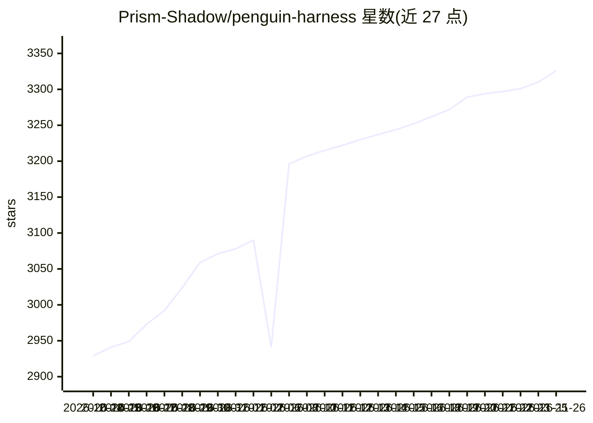

# Prism-Shadow/penguin-harness

⭐ 3,326 · TypeScript · Apache-2.0 · 推送 2026-11-25 · [GitHub](https://github.com/Prism-Shadow/penguin-harness) · [官网](https://penguin.ooo/) · 组织维护 · 中文 README

**Agent 自进化（RSI）框架：固定模型，自动优化 prompt/Skill/工具**

PenguinHarness 是面向递归自我改进（RSI）的开源框架：模型保持不变，由 agent 迭代改进另一个 agent 的 harness（prompt、Skills、工具、hooks），每轮候选生成快照并把得分记录到评估中心。内置 10 种 RSI 算法插件（OPRO、APE、ACE、AWM、SkillAdam、TRACE 等）与 17 个 Benchmark（Harbor 任务运行于 Docker）。以桌面应用、Web App、CLI、SDK 四种形态提供，桌面安装包覆盖 macOS/Windows/Linux，另提供 Docker 镜像与离线安装包。

## 筛选速览

| 维度 | 判定 | 备注 |
|---|---|---|
| AI 角色 | `ai-ecosystem` | LLM/agent 周边工具 |
| 许可风险 | `permissive` | Apache-2.0 |
| 部署形态 | `self-host` | docker 或自建部署 |
| 模型依赖 | — | README 未给出锁定关系 |
| 硬件要求 | — | 无带数字的原话,不猜 |
| 安装摩擦 | `low` | 无编译、无系统依赖或容器化 |
| 成熟度 | — | 结构信号不足 |

## 能力要点

- 10 种 RSI 算法以插件形式运行在统一 Benchmark 与快照机制上
- 一句话生成 agent 应用（含页面与运行说明）
- 内置 17 个 Benchmark，以 Harbor 任务在 Docker 中运行
- 统一 Agent API 以 HTTP 输入、AMSP 事件流输出，支持 A2UI 界面回复

## 适用场景

- 为固定模型自动优化 agent 的 prompt 与 Skills
- 在统一 Benchmark 上评测对比多轮自进化候选
- 用一句话让 agent 生成并运行一个具体场景的应用

## 场景标签

`模型评测` `Agent 框架` `提示工程` · 领域:Agent 开发

## 证据(README 行号)

> L37: PenguinHarness is an open-source framework for agent self-evolution (recursive self-improvement, RSI). The model st
> L39: - **Every RSI algorithm in one framework.** Default, OPRO, APE, ACE, AWM, SkillAdam, SkillOpt, OpenSkill and TRACE 
> L119: These are the model families we focus on supporting. The app's **Models** page lists each variant and its provider

## 星数曲线

2026-10-24 2,929 → 2026-11-26 3,326（+397）

---
*卡片 v1 · prompt 1.4 · 生成 2026-11-26 · 置信度 high · 依据 README sha `29ff7537056c` · [字段定义](../../DATASET.md)*
