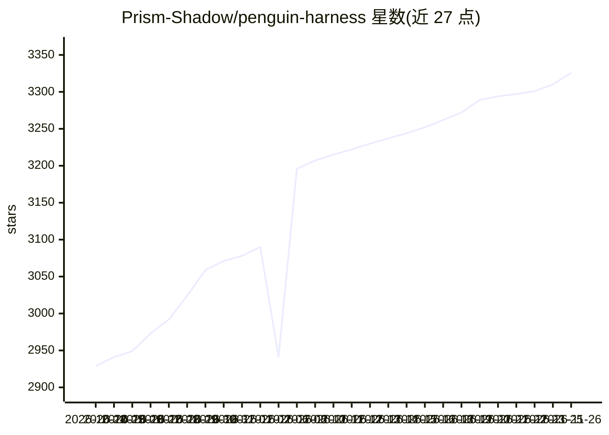

# Prism-Shadow/penguin-harness

⭐ 3,326 · TypeScript · Apache-2.0 · 推送 2026-11-25 · [GitHub](https://github.com/Prism-Shadow/penguin-harness) · [官网](https://penguin.ooo/) · 组织维护 · 中文 README

**面向开发者的 agent 自进化（RSI）框架与运行平台**

开源的递归自我改进框架：模型固定，由 agent 迭代优化 harness（提示词、Skills、工具与 hooks）。内置 10 种 RSI 算法插件（OPRO、APE、ACE、AWM、SkillAdam、TRACE 等）与 17 个基准评测，候选版本快照后打分入评测中心。支持一句话生成 agent 应用、浏览器自动化、远程 ssh 机器与统一 Agent API（AMSP 事件流）。以桌面应用、Web App、CLI、SDK、Docker 镜像分发，Apache-2.0，由 PrismShadow 团队维护。

## 筛选速览

| 维度 | 判定 | 备注 |
|---|---|---|
| AI 角色 | `ai-ecosystem` | LLM/agent 周边工具 |
| 许可风险 | `permissive` | Apache-2.0 |
| 部署形态 | `self-host` | docker 或自建部署 |
| 模型依赖 | locked-api |  |
| 硬件要求 | — | 无带数字的原话,不猜 |
| 安装摩擦 | `low` | 无编译、无系统依赖或容器化 |
| 成熟度 | — | 结构信号不足 |

## 能力要点

- 10 种 RSI 算法以插件形式运行在同一评测与快照机制上
- 内置 17 个基准，以 Harbor 任务在 Docker 中运行
- 一句话生成含前端页面与服务端代码的 agent 应用
- 统一 Agent API 经 HTTP 以 AMSP 事件流返回运行结果，回复可携带 A2UI 组件

## 适用场景

- 让 agent 自动迭代优化另一个 agent 的提示词与 Skills
- 一句话生成业务 agent 应用（如合同审查工作台）
- 用内置基准对比不同 harness 在同一模型上的得分与成本
- 通过 CLI/SDK 把 agent 接入外部应用

## 场景标签

`提示工程` `模型评测` `浏览器自动化` `编码 Agent` · 领域:Agent 开发

## 证据(README 行号)

> L37: PenguinHarness is an open-source framework for agent self-evolution (recursive self-improvement, RSI). The model st
> L39: - **Every RSI algorithm in one framework.** Default, OPRO, APE, ACE, AWM, SkillAdam, SkillOpt, OpenSkill and TRACE 
> L93:  One unified API connects any agent to any external app: send input over HTTP and read the run back as a stream of 

## 星数曲线

2026-10-24 2,929 → 2026-11-26 3,326（+397）

---
*卡片 v1 · prompt 1.4 · 生成 2026-11-24 · 置信度 high · 依据 README sha `aa494bed8a2f` · [字段定义](../../DATASET.md)*
