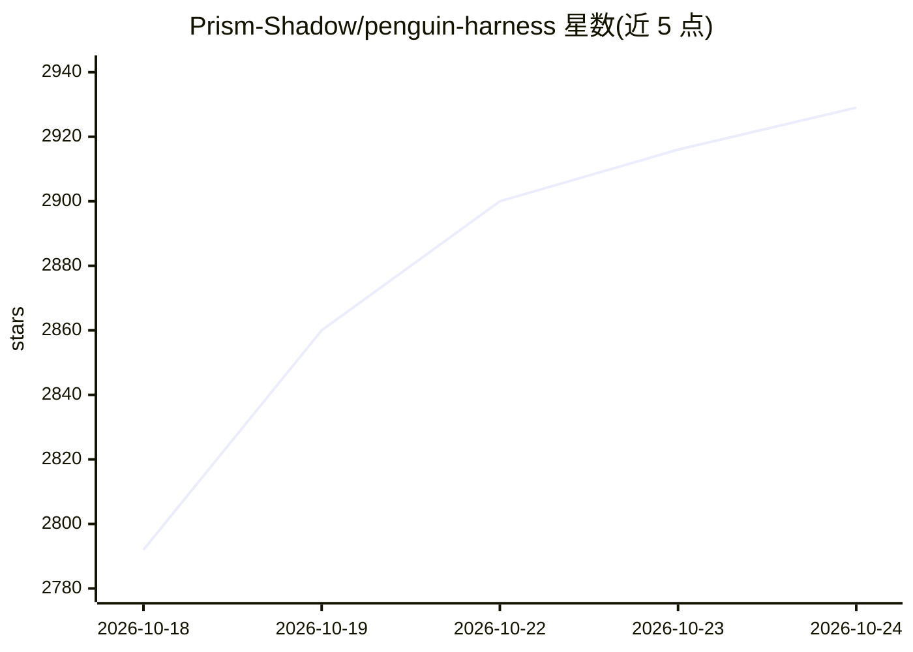

# Prism-Shadow/penguin-harness

⭐ 2,941 · TypeScript · Apache-2.0 · 推送 2026-10-24 · [GitHub](https://github.com/Prism-Shadow/penguin-harness) · [官网](https://penguin.ooo/) · 组织维护 · 中文 README

**开发者用的智能体自进化（RSI）框架，让 agent 迭代改进 harness**

开源的递归自我改进（RSI）框架：模型固定，进化对象是 harness 的 prompts、Skills、工具与 hooks。内置 default/OPRO/APE/ACE/AWM 五种 RSI 算法插件，配七项 Benchmark（以 Harbor 任务在 Docker 中运行）、评分板与快照，agent 逐轮改进另一 agent。支持一句话生成 agent 应用、浏览器自动化、远程机器、Agent API（AMSP 流式事件）。以桌面应用、Web App、CLI、SDK 与 Docker 形态运行，支持闭源与开源模型及自定义 OpenAI 协议端点，Apache-2.0 许可，由 PrismShadow 团队维护。

## 筛选速览

| 维度 | 判定 | 备注 |
|---|---|---|
| AI 角色 | `ai-ecosystem` | LLM/agent 周边工具 |
| 许可风险 | `permissive` | Apache-2.0 |
| 部署形态 | `self-host` | docker 或自建部署 |
| 模型依赖 | locked-api |  |
| 硬件要求 | — | 无带数字的原话,不猜 |
| 安装摩擦 | `low` | 无编译、无系统依赖或容器化 |
| 成熟度 | — | 结构信号不足 |

## 能力要点

- 五种 RSI 算法（default/OPRO/APE/ACE/AWM）以插件形式运行于同一套内置 Benchmark 与快照体系
- 桌面应用 / Web App / CLI / SDK / Docker 多形态交付，共享 ~/.penguin/data
- 一句话生成 agent 应用，支持浏览器自动化、远程机器与 AMSP 流式 Agent API
- 支持闭源与开源模型，自定义 OpenAI 协议端点可接入 1000+ 模型

## 适用场景

- 跑 Benchmark 对比不同 RSI 算法对 agent harness 的改进效果
- 用一句话描述需求让 agent 生成可运行的 agent 应用
- 在本地或服务器上统一运行、评测和自进化多个 agent

## 场景标签

`Agent 框架` `模型评测` · 领域:Agent 开发

## 证据(README 行号)

> L35: PenguinHarness is an open-source framework for agent self-evolution (recursive self-improvement, RSI). The model st
> L37: - **Every RSI algorithm in one framework.** Default, OPRO, APE, ACE and AWM ship as plugins and run on the same bui
> L43: Pick an algorithm, pick a Benchmark, and an agent improves another agent round by round. Every candidate is a new v

## 星数曲线

2026-10-18 2,792 → 2026-10-24 2,929（+137）

---
*卡片 v1 · prompt 1.4 · 生成 2026-10-21 · 置信度 high · 依据 README sha `b48e854f4fc0` · [字段定义](../../DATASET.md)*
