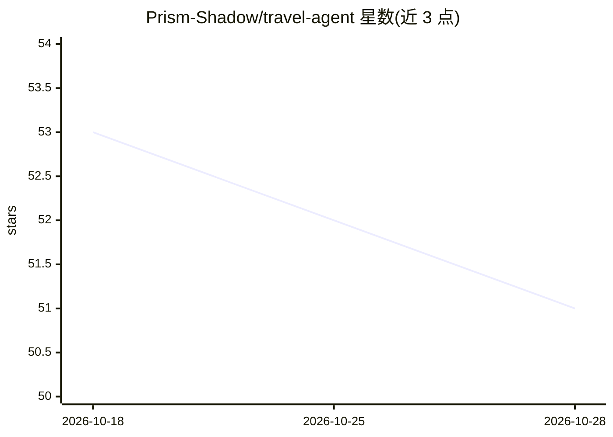

# Prism-Shadow/travel-agent

⭐ 51 · TypeScript · Apache-2.0 · 推送 2026-09-08 · [GitHub](https://github.com/Prism-Shadow/travel-agent) · [官网](https://opentravelagent.vercel.app) · 组织维护 · 中文 README

**在真实旅游网站上代查代订的桌面 AI 旅行助手**

Electron 桌面应用：用户用自然语言描述行程需求，agent 在应用内浏览器或用户自己的 Chrome（通过 Travel Browser 扩展）中导航旅游网站、读页填表，完成搜索比价与表单填写，并在支付页前停止，由用户付款。支持按行程组织多个会话、跨会话共享目的地/日期/预算等信息。需自带模型 API key（如 Anthropic、DeepSeek），提供 macOS/Windows/Linux 安装包与源码运行两种方式；当前构建未签名、定位为开发预览。

## 筛选速览

| 维度 | 判定 | 备注 |
|---|---|---|
| AI 角色 | `ai-native` | 本体是模型或模型工具 |
| 许可风险 | `permissive` | Apache-2.0 |
| 部署形态 | `desktop` | 安装包/桌面程序 |
| 模型依赖 | locked-api |  |
| 硬件要求 | — | 无带数字的原话,不猜 |
| 安装摩擦 | `low` | 无编译、无系统依赖或容器化 |
| 成熟度 | `idea` | |

## 能力要点

- 对话+浏览器同屏工作流，agent 在真实网站上读页填表
- 两种浏览模式：应用内浏览器或经 Chrome 扩展接入用户自己的 Chrome
- 预订流程在支付页前无条件停止，付款由用户完成
- 按行程组织多会话，目的地/日期/预算等信息跨会话共享

## 适用场景

- 让 AI 在携程上按预算、评分、退改政策筛选酒店
- 从小红书攻略生成行程并生成高德路线
- 在同一窗口边聊边看 agent 操作旅游网站

## 场景标签

`浏览器自动化` `AI 助手` · 领域:效率与自动化

## 证据(README 行号)

> L21: Travel Agent is a **desktop travel assistant**. Describe what you need, then follow the agent as
> L68: **Desktop app · macOS, Windows and Linux · Bring your own model API key**

## 星数曲线

2026-10-18 53 → 2026-10-28 51（-2）

---
*卡片 v1 · prompt 1.4 · 生成 2026-10-24 · 置信度 mid · 依据 README sha `6340d537514c` · [字段定义](../../DATASET.md)*
