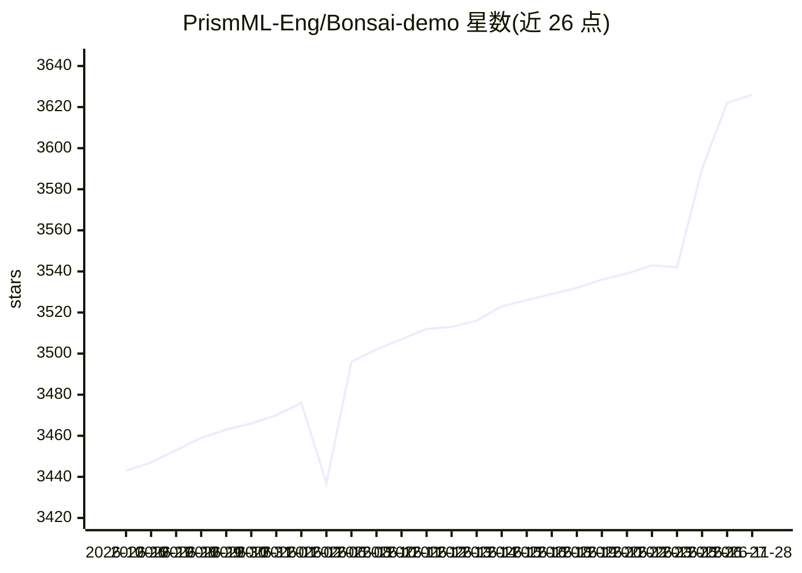

# PrismML-Eng/Bonsai-demo

⭐ 3,626 · Shell · Apache-2.0 · 推送 2026-11-26 · [GitHub](https://github.com/PrismML-Eng/Bonsai-demo) · [官网](https://prismml.com/) · 组织维护

**本地运行 Bonsai 系列量化模型的演示安装与启动套件**

提供脚本化流程在 Mac（Metal）、Linux/Windows（CUDA/Vulkan/ROCm）或 CPU 上下载并运行 Bonsai 2.5 27B 及 Bonsai 2 系列（2B/4B/9B/27B）的 GGUF 与 MLX 量化模型：setup.sh 负责安装系统依赖、创建 venv、拉取 llama.cpp 二进制与模型权重，随后启动本地服务器（端口 8080）提供聊天、视觉输入与 OpenAI 风格工具调用，并可选安装 Open WebUI 与代码解释器。默认使用 PrismML fork 以支持 PQ2_0/PTQ1_0 打包格式。

## 筛选速览

| 维度 | 判定 | 备注 |
|---|---|---|
| AI 角色 | `ai-ecosystem` | LLM/agent 周边工具 |
| 许可风险 | `permissive` | Apache-2.0 |
| 部署形态 | `None` |  |
| 模型依赖 | local-ok | 支持本地模型 |
| 硬件要求 | `cpu-ok` | |
| 安装摩擦 | `high` | 编译与系统依赖俱全 |
| 成熟度 | — | 结构信号不足 |

## 能力要点

- 两条命令完成模型下载与本地服务器启动（chat/vision/tools）
- GGUF 与 MLX 双格式，支持 llama.cpp（含官方上游 Q2_0）与 mlx-vlm
- 内置 MTP draft head，支持投机解码加速（CUDA/Metal 默认开启）
- 262K 上下文、原生 tool_calls 与 MCP 支持

## 适用场景

- 在本地 Mac 或 GPU 机器上运行 Bonsai 27B 进行对话与视觉问答
- 用本地小模型（2B/4B/9B）搭建低资源推理服务
- 测试带工具调用的 agentic 工作流

## 场景标签

`推理引擎` `模型量化` `聊天机器人` · 领域:对话与助手

## 证据(README 行号)

> L16: Run **Bonsai 2.5 27B**, and the **Bonsai 2** family (2B, 4B, 9B, 27B), locally on Mac (Metal),
> L73: Quick Start below gets you there in two commands: `./setup.sh` downloads Bonsai 2.5 27B, then
> L144: `setup.sh` fetches the llama.cpp binaries for your machine and the Bonsai 2.5 27B

## 星数曲线

2026-10-26 3,443 → 2026-11-28 3,626（+183）

---
*卡片 v1 · prompt 1.4 · 生成 2026-11-26 · 置信度 high · 依据 README sha `ec893510eb47` · [字段定义](../../DATASET.md)*
