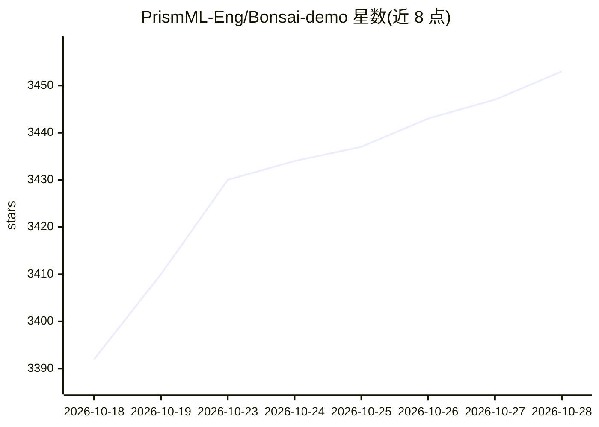

# PrismML-Eng/Bonsai-demo

⭐ 3,453 · Shell · Apache-2.0 · 推送 2026-10-25 · [GitHub](https://github.com/PrismML-Eng/Bonsai-demo) · [官网](https://prismml.com/) · 组织维护

**在本地运行 Bonsai 2 系列模型（2B-27B）的官方演示环境**

PrismML 的 Bonsai 2 模型演示仓库：提供 setup 脚本自动安装依赖、下载模型权重（默认 27B PQ2_0，7.8GB）与预编译二进制，通过 llama.cpp（Mac Metal/Linux/Windows CUDA、Vulkan、ROCm 或 CPU）或 Apple Silicon 的 MLX 后端本地运行。模型为推理型，支持视觉输入、OpenAI 风格工具调用、262K 上下文。附带 Open WebUI 聊天界面与代码解释器（可跳过），可用环境变量切换模型规模与推理档位。

## 筛选速览

| 维度 | 判定 | 备注 |
|---|---|---|
| AI 角色 | `ai-native` | 本体是模型或模型工具 |
| 许可风险 | `permissive` | Apache-2.0 |
| 部署形态 | `None` |  |
| 模型依赖 | local-ok | 支持本地模型 |
| 硬件要求 | — | 无带数字的原话,不猜 |
| 安装摩擦 | `high` | 编译与系统依赖俱全 |
| 成熟度 | — | 结构信号不足 |

## 能力要点

- Bonsai 2 提供 2B/4B/9B/27B 四种规模，GGUF 与 MLX 双格式
- 支持视觉输入、工具调用与 MCP 服务器
- setup.sh 一键安装：自动检测 GPU（Metal/CUDA/ROCm/Vulkan）并全量卸载
- 聊天 UI 内可逐会话调节推理档位（Off 到 Max）

## 适用场景

- 在本地跑带视觉与工具调用的推理型对话模型
- 按机器条件选择更小的模型规模做轻量部署
- 通过 Open WebUI 使用带代码解释器的 agent 演示

## 场景标签

`推理引擎` `聊天机器人` · 领域:对话与助手

## 证据(README 行号)

> L15: Run **Bonsai 2 2B, 4B, 9B, and 27B** locally on Mac (Metal), Linux/Windows (CUDA, Vulkan, ROCm), or CPU.
> L46: Quick Start below gets you there in two commands: `./setup.sh` downloads Bonsai 2 27B, then

## 星数曲线

2026-10-18 3,392 → 2026-10-28 3,453（+61）

---
*卡片 v1 · prompt 1.4 · 生成 2026-10-20 · 置信度 high · 依据 README sha `7b8e9d575f2c` · [字段定义](../../DATASET.md)*
