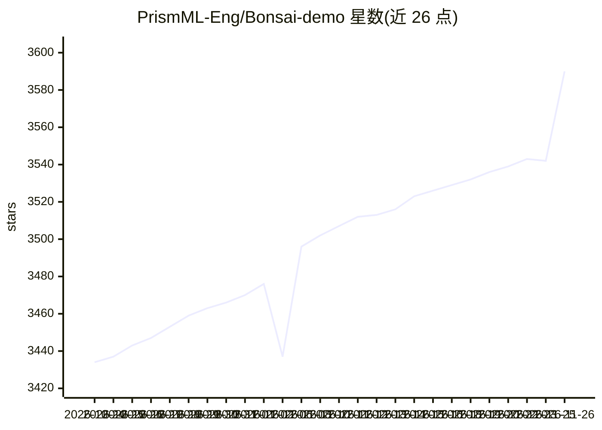

# PrismML-Eng/Bonsai-demo

⭐ 3,590 · Shell · Apache-2.0 · 推送 2026-11-25 · [GitHub](https://github.com/PrismML-Eng/Bonsai-demo) · [官网](https://prismml.com/) · 组织维护

**在本地 Mac/Linux/Windows 运行 Bonsai 2 系列模型的一键脚本集**

PrismML 提供的 Bonsai 2 模型（2B/4B/9B/27B）本地运行演示工程：setup.sh 自动安装依赖、下载 GGUF/MLX 权重与预编译 llama.cpp 二进制，脚本启动 llama-server 或 MLX 运行时提供聊天、视觉、工具调用服务（默认 localhost:8080）。支持 OpenAI 风格 tool_calls 与 MCP、按对话调节推理力度、262K 上下文、多种量化打包（Q2_0/PQ2_0/PT1_0，后两种需 PrismML fork）。可另装 Open WebUI 与 Jupyter 代码解释器。

## 筛选速览

| 维度 | 判定 | 备注 |
|---|---|---|
| AI 角色 | `ai-native` | 本体是模型或模型工具 |
| 许可风险 | `permissive` | Apache-2.0 |
| 部署形态 | `None` |  |
| 模型依赖 | local-ok | 支持本地模型 |
| 硬件要求 | `cpu-ok` | |
| 安装摩擦 | `high` | 编译与系统依赖俱全 |
| 成熟度 | — | 结构信号不足 |

## 能力要点

- 提供 2B/4B/9B/27B 四种规模的 GGUF 与 MLX 2-bit 权重
- 1.75 bits/weight 的 PTQ1_0 打包及可选 PQ2_0 打包
- 支持图片/PDF 视觉输入与 OpenAI 风格 tool_calls 及 MCP 服务器
- 官方 llama.cpp b11556+ 支持 Q2_0 格式，PQ2_0/PTQ1_0 需 PrismML fork

## 适用场景

- 在本地 Mac（Metal/MLX）或 CUDA/Vulkan/ROCm/CPU 机器上运行 Bonsai 2 模型聊天
- 通过本地 API 调用带工具调用与推理预算的模型服务
- 测试不同量化打包在自家硬件上的内存与速度表现

## 场景标签

`推理引擎` `模型量化` · 领域:训练与推理

## 证据(README 行号)

> L15: Run **Bonsai 2 2B, 4B, 9B, and 27B** locally on Mac (Metal), Linux/Windows (CUDA, Vulkan, ROCm), or CPU.
> L46: Quick Start below gets you there in two commands: `./setup.sh` downloads Bonsai 2 27B, then
> L47: `./scripts/start_llama_server.sh` gives you chat, vision and tools at http://localhost:8080.

## 星数曲线

2026-10-24 3,434 → 2026-11-26 3,590（+156）

---
*卡片 v1 · prompt 1.4 · 生成 2026-11-23 · 置信度 high · 依据 README sha `2200de29a944` · [字段定义](../../DATASET.md)*
