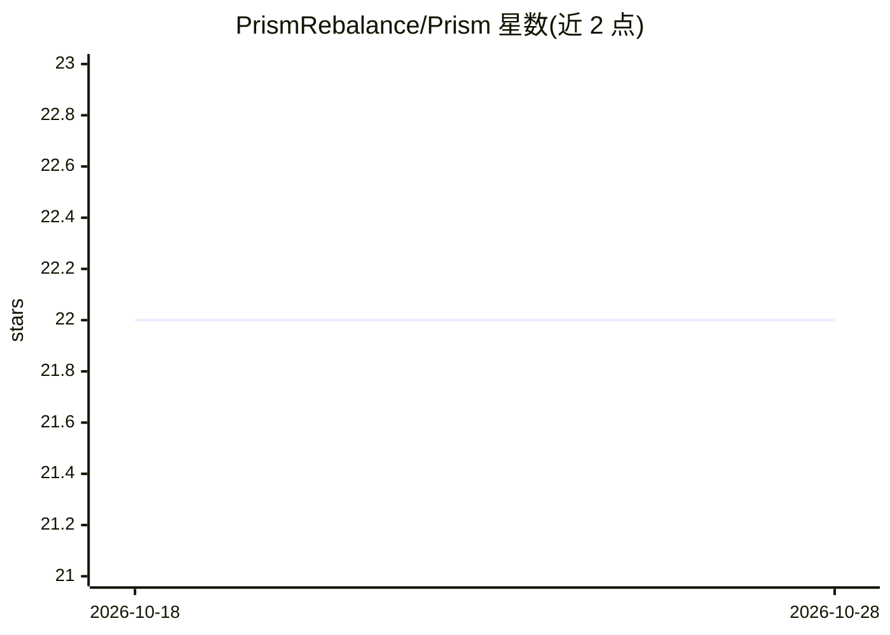

# PrismRebalance/Prism

⭐ 22 · TypeScript · MIT · 推送 2026-09-04 · [GitHub](https://github.com/PrismRebalance/Prism) · [官网](https://pons.family/) · 组织维护

**Robinhood 账户的漂移感知再平衡器：先计价执行摩擦再出交易**

面向 Robinhood 账户（默认加密资产组合）的组合再平衡工具：读取账户余额与美元计价，对照目标配置计算每个 sleeve 的漂移并排序，据此构建买卖腿，随后对每笔候选订单做执行质量、最小交易量、价格冲击与现金储备的 preflight 检查，输出可执行/仅预览/跳过三种结果。提供再平衡阈值、最小交易量、价格冲击上限、现金储备下限与预览模式等风控参数，目标配置可自定义。使用 Claude Agent SDK 构建。README 未给出具体安装命令。

## 筛选速览

| 维度 | 判定 | 备注 |
|---|---|---|
| AI 角色 | `ai-enhanced` | 去掉 AI 部分产品仍成立 |
| 许可风险 | `permissive` | MIT |
| 部署形态 | `None` |  |
| 模型依赖 | — | README 未给出锁定关系 |
| 硬件要求 | — | 无带数字的原话,不猜 |
| 安装摩擦 | `low` | 无编译、无系统依赖或容器化 |
| 成熟度 | — | 结构信号不足 |

## 能力要点

- 五步循环：载入账户→测漂移→排优先级→构建订单→preflight 检查
- preflight 校验执行质量、最小交易量、价格冲击与现金储备约束
- 输出区分 executable / preview-only / skipped 三种终态
- 提供再平衡阈值、价格冲击上限、现金储备下限等风控参数

## 适用场景

- 让 Robinhood 加密账户自动贴近目标配置而不用手工表格
- 在扣除点差和费用后判断漂移是否值得修正
- 下单前预览再平衡计划并守住现金储备下限

## 场景标签

 · 领域:金融/加密资产管理

## 证据(README 行号)

> L5: **Drift-aware portfolio rebalancer for Robinhood accounts.**
> L12: Built with Claude Agent SDK
> L80: 1. load current Robinhood account balances and price them in USD

## 星数曲线

2026-10-18 22 → 2026-10-28 22（+0）

---
*卡片 v1 · prompt 1.4 · 生成 2026-10-27 · 置信度 mid · 依据 README sha `b54fda331eed` · [字段定义](../../DATASET.md)*
