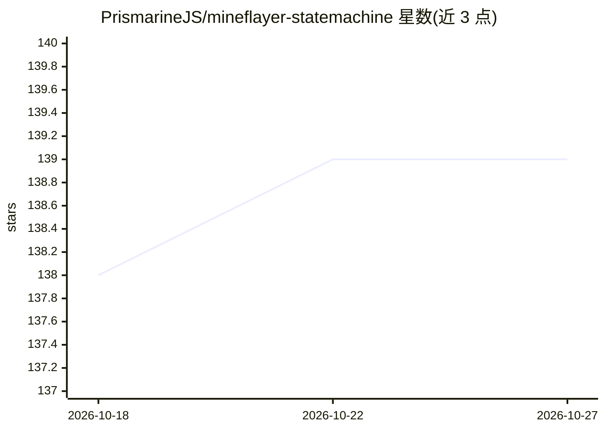

# PrismarineJS/mineflayer-statemachine

⭐ 139 · TypeScript · MIT · 推送 2026-07-08 · [GitHub](https://github.com/PrismarineJS/mineflayer-statemachine) · [官网](https://thedudefromci.github.io/mineflayer-statemachine/) · 组织维护

**Mineflayer 状态机插件：帮助编写可扩展的 Minecraft 机器人行为**

为 Mineflayer 提供高层状态机 API 的 Node.js 插件：将机器人行为拆分为单一职责的独立模块，再通过顶层组件连接这些模块并传递控制权，用于组织和扩展复杂 bot 行为逻辑。依赖 mineflayer-pathfinder 提供移动行为，需在启动状态机前加载。提供 Webserver 与 Mining 两个演示视频及 API 文档，MIT 许可，接受 PR 与 Issue 贡献。

## 筛选速览

| 维度 | 判定 | 备注 |
|---|---|---|
| AI 角色 | `ai-ecosystem` | LLM/agent 周边工具 |
| 许可风险 | `permissive` | MIT |
| 部署形态 | `library` | 以包/库形式分发 |
| 模型依赖 | — | README 未给出锁定关系 |
| 硬件要求 | — | 无带数字的原话,不猜 |
| 安装摩擦 | `low` | 无编译、无系统依赖或容器化 |
| 成熟度 | — | 结构信号不足 |

## 能力要点

- 在 Mineflayer 之上提供状态机 API
- 行为拆分为单一职责模块并在顶层组合
- 依赖 mineflayer-pathfinder 实现移动行为

## 适用场景

- 为 Minecraft 机器人编写可管理的行为树
- 将复杂 bot AI 逻辑模块化以便扩展与维护

## 场景标签

 · 领域:游戏机器人开发

## 证据(README 行号)

> L2:  This project is a plugin designed for Mineflayer that adds a high level API for writing state machines. As bot AI c
> L6: Mineflayer-StateMachine is a plugin for Mineflayer. It aims to add a flexible and customizable state machine API on 

## 星数曲线

2026-10-18 138 → 2026-10-27 139（+1）

---
*卡片 v1 · prompt 1.4 · 生成 2026-10-22 · 置信度 high · 依据 README sha `34fbfe48eb3f` · [字段定义](../../DATASET.md)*
