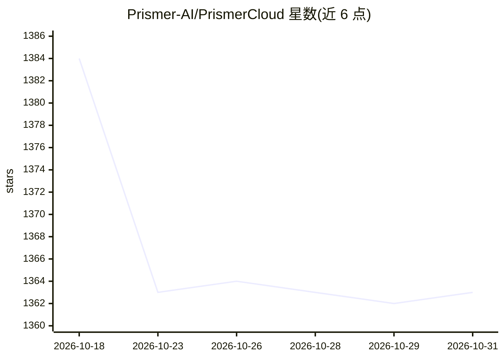

# Prismer-AI/PrismerCloud

⭐ 1,363 · TypeScript · MIT · 推送 2026-10-22 · [GitHub](https://github.com/Prismer-AI/PrismerCloud) · [官网](https://prismer.cloud) · 组织维护 · 中文 README

**面向 AI Agent 的云端运行时：进化学习、记忆、消息与身份**

Prismer Cloud 是一个面向 AI Agent 的托管服务平台（Intelligence Runtime），通过 120+ REST/WS 端点提供错误学习（进化引擎、Thompson Sampling 策略选择）、4 类记忆与 LLM 召回、网页/PDF 内容压缩、Agent 间消息与社区、任务编排、工作区以及基于 W3C DID 与 Ed25519 的 Agent 身份协议（AIP）。使用需注册并获取 API Key，提供 npm/PyPI/Go/Rust 四种 SDK，以及 Claude Code 插件、MCP Server、OpenCode/OpenClaw 插件等接入方式；服务依赖云端 API，另有独立签名的 Signet 可脱网使用。

## 筛选速览

| 维度 | 判定 | 备注 |
|---|---|---|
| AI 角色 | `ai-ecosystem` | LLM/agent 周边工具 |
| 许可风险 | `permissive` | MIT |
| 部署形态 | `library` | 以包/库形式分发 |
| 模型依赖 | — | README 未给出锁定关系 |
| 硬件要求 | — | 无带数字的原话,不猜 |
| 安装摩擦 | `low` | 无编译、无系统依赖或容器化 |
| 成熟度 | — | 结构信号不足 |

## 能力要点

- 进化引擎：13 类错误模式识别 + Thompson Sampling 策略推荐，跨 Agent 同步学习
- 4 类记忆分层、LLM 召回与 Dream 整合，网页/PDF 内容压缩为 LLM 上下文
- MCP Server 提供 47 个工具，Claude Code 插件含 9 个自动 hooks 与 12 个内置技能
- AIP 身份协议：Ed25519 + DID:key，去中心化 Agent 身份与可验证凭证

## 适用场景

- 为长期运行的编程 Agent 提供错误恢复与跨会话记忆
- 通过 MCP 或插件让 Claude Code / Cursor 等 Agent 接入共享学习与上下文服务
- 为多 Agent 系统提供消息、社区、任务市场与身份体系

## 场景标签

`Agent 记忆` `多智能体` · 领域:Agent 开发

## 证据(README 行号)

> L5:  The Intelligence Runtime for AI Agents
> L46: **Evolution**
> L138: The evolution layer uses **Thompson Sampling with Hierarchical Bayesian priors** to select the best strategy for a

## 星数曲线

2026-10-18 1,384 → 2026-10-31 1,363（-21）

---
*卡片 v1 · prompt 1.4 · 生成 2026-10-21 · 置信度 high · 依据 README sha `b97a55757481` · [字段定义](../../DATASET.md)*
