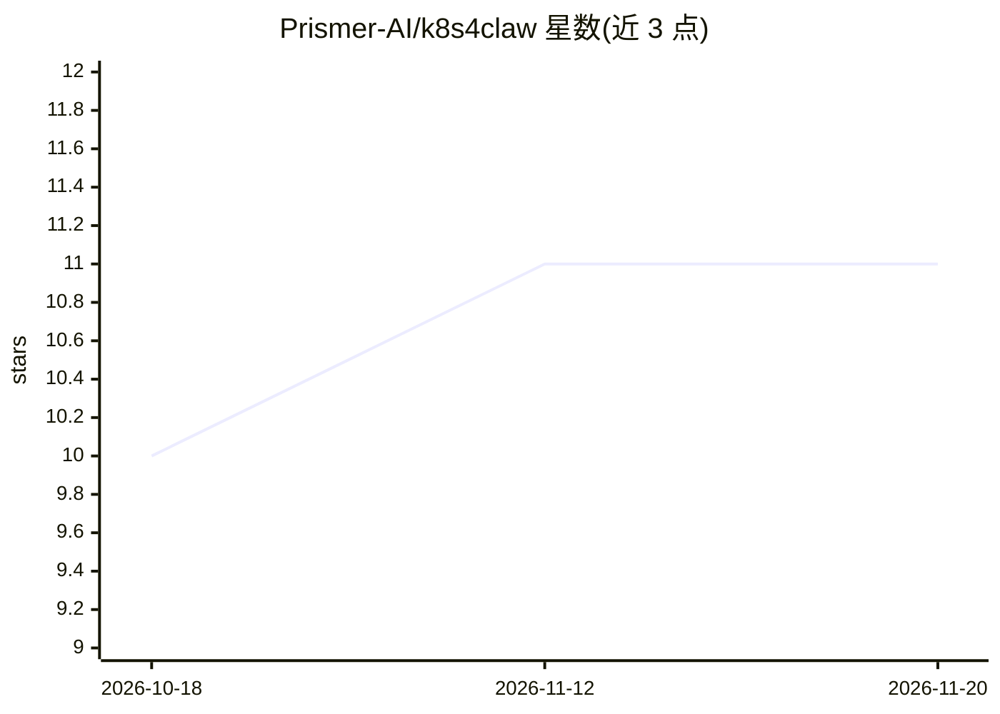

# Prismer-AI/k8s4claw

⭐ 11 · Go · Apache-2.0 · 推送 2026-10-13 · [GitHub](https://github.com/Prismer-AI/k8s4claw) · [官网](https://github.com/Prismer-AI/k8s4claw) · 组织维护

**让 AI agent 在 Kubernetes 上自管基础设施的 operator**

一个 Kubernetes operator（Go/kubebuilder 编写），通过单个 Claw CRD 声明式管理 AI agent 的 StatefulSet、Service、PVC、NetworkPolicy、RBAC 等资源。核心机制是将 LLM 排除在集群写路径之外：LLM 只能提交 ops-intent 注解，Go reconciler 按 5 动作白名单校验并执行变更，自动修复附 Ed25519 签名审计回执；新问题由 Companion Claw 经 Slack 人工审批后执行。提供 IPC 总线（WAL/DLQ/背压）、自动更新熔断、S3 归档、Slack/Discord 通道 sidecar、Prometheus 指标与 Go SDK。安装依赖 Helm 或源码构建。

## 筛选速览

| 维度 | 判定 | 备注 |
|---|---|---|
| AI 角色 | `ai-ecosystem` | LLM/agent 周边工具 |
| 许可风险 | `permissive` | Apache-2.0 |
| 部署形态 | `library` | 以包/库形式分发 |
| 模型依赖 | — | README 未给出锁定关系 |
| 硬件要求 | — | 无带数字的原话,不猜 |
| 安装摩擦 | `low` | 无编译、无系统依赖或容器化 |
| 成熟度 | — | 结构信号不足 |

## 能力要点

- LLM 不可直接 patch 工作负载，仅通过 intent 注解 + 5 动作白名单由 reconciler 变更
- ClawOpsController 监听 OOMKilled/CrashLoop 等状态并按确定性规则自动修复
- 自动执行动作生成 Ed25519 签名审计回执，LLM 失败 3 次重试后降级为人工通知
- 单一 Claw CRD 管理 StatefulSet/Service/PVC/NetworkPolicy/RBAC 等资源

## 适用场景

- 在生产 Kubernetes 集群中托管 AI agent 并自动处理 OOM/CrashLoop
- 要求 LLM 无集群写权限、变更需审计留痕的安全场景
- 为 agent 配置定时快照、S3 归档与多通道消息接入

## 场景标签

`Agent 框架` `工作流自动化` · 领域:Agent 开发

## 证据(README 行号)

> L15: k8s4claw keeps the LLM out of the cluster's write path. **The agent's ServiceAccount cannot patch workload objects.
> L33: Running AI agents in production means solving the same problems over and over: secret management, persistent storag
> L79: ## Supported Runtimes

## 星数曲线

2026-10-18 10 → 2026-11-20 11（+1）

---
*卡片 v1 · prompt 1.4 · 生成 2026-11-18 · 置信度 high · 依据 README sha `069fa923094d` · [字段定义](../../DATASET.md)*
