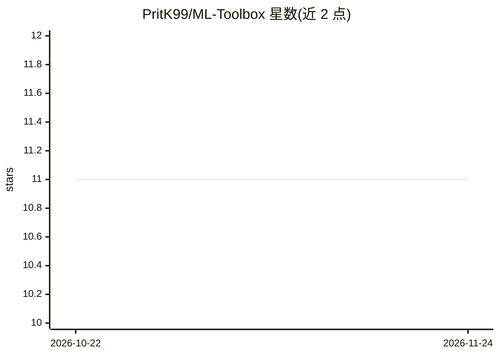

# PritK99/ML-Toolbox

⭐ 11 · Jupyter Notebook · 推送 2026-08-26 · [GitHub](https://github.com/PritK99/ML-Toolbox) · 个人维护

**机器学习算法学习仓库：从零实现经典算法与深度模型**

以探索机器学习与优化技术为动机的个人学习仓库，讲解知识先验与数据结合的三种途径（模型设计选择、数据、优化），并按监督学习等目录组织算法实现：经典算法（感知机、线性回归等）用 C++ 实现，深度学习模型（VAE、扩散模型等）用 Python 实现。安装方式为 git clone 源码，需安装 OpenCV（C++）与 pip 依赖。仓库自述仍在开发中，将长期处于进行时状态。

## 筛选速览

| 维度 | 判定 | 备注 |
|---|---|---|
| AI 角色 | `ai-knowledge` | 知识聚合/清单类 |
| 许可风险 | `none` | — |
| 部署形态 | `library` | 以包/库形式分发 |
| 模型依赖 | — | README 未给出锁定关系 |
| 硬件要求 | — | 无带数字的原话,不猜 |
| 安装摩擦 | `low` | 无编译、无系统依赖或容器化 |
| 成熟度 | `idea` | |

## 能力要点

- 经典算法以 C++ 实现（含 OpenCV 依赖）
- 深度学习模型（VAE、扩散模型）以 Python 实现
- 提供知识先验与数据结合的理论讲解
- 引用 Cornell CS4780、MIT 6.036 等课程资料

## 适用场景

- 按算法类别查阅从零实现的机器学习代码
- 学习机器学习与优化方法的理论讲解
- 对照课程讲义复现经典算法实现

## 场景标签

`教程课程` · 领域:学习与行业

## 证据(README 行号)

> L13: Machine learning and optimization methods are deeply fascinating fields of study. The motivation behind this projec
> L53: ## List of Algorithms
> L78: Classical algorithms (such as the Perceptron and Linear Regression) are implemented in C++, while deep learning mod

## 星数曲线

2026-10-22 11 → 2026-11-24 11（+0）

---
*卡片 v1 · prompt 1.4 · 生成 2026-11-18 · 置信度 high · 依据 README sha `f64951e9b87a` · [字段定义](../../DATASET.md)*
