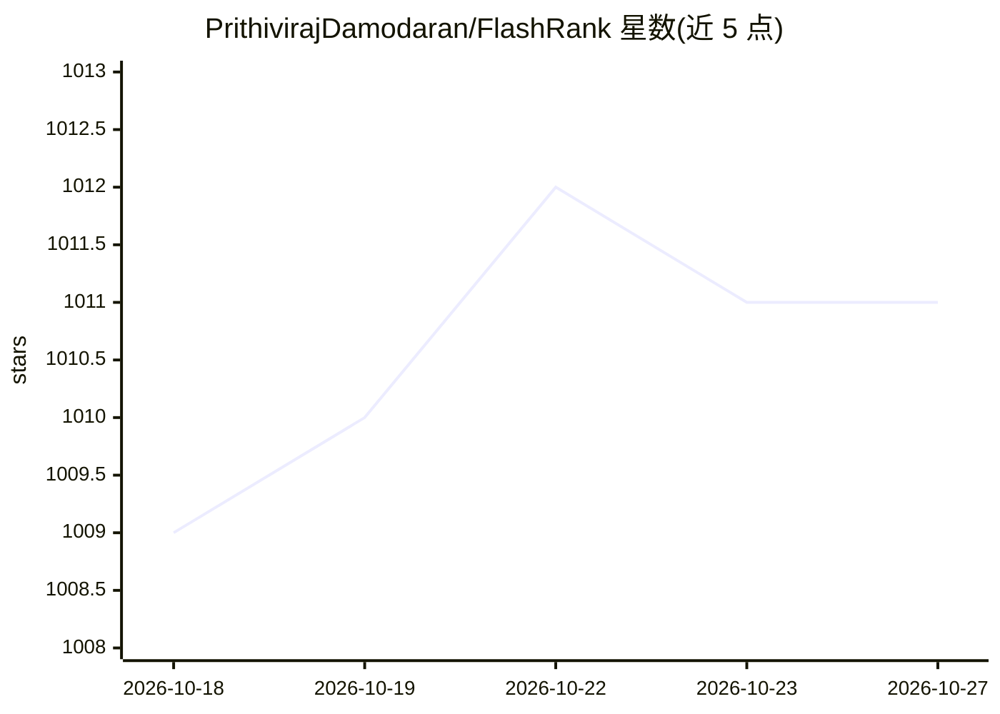

# PrithivirajDamodaran/FlashRank

⭐ 1,011 · Python · Apache-2.0 · 推送 2026-07-11 · [GitHub](https://github.com/PrithivirajDamodaran/FlashRank) · 个人维护

**为检索管线添加轻量重排序的 Python 库**

Python 库，在既有搜索与检索管线中对候选段落做重排序，再交给 LLM 使用。支持基于交叉编码器的 Pairwise/Pointwise 重排器与基于 LLM 的 Listwise 重排器，内置 ms-marco-TinyBERT（约 4MB 默认模型）、MiniLM、rank-T5-flan、MultiBERT 多语种模型及 4-bit 量化的 rank_zephyr_7b（约 4GB）等可选模型。无需 Torch 或 Transformers 依赖，可在 CPU 上运行，面向需要控制包体积与冷启动时间的场景（如 Serverless 部署）。通过 pip 安装，listwise 需额外安装可选依赖。

## 筛选速览

| 维度 | 判定 | 备注 |
|---|---|---|
| AI 角色 | `ai-ecosystem` | LLM/agent 周边工具 |
| 许可风险 | `permissive` | Apache-2.0 |
| 部署形态 | `library` | 以包/库形式分发 |
| 模型依赖 | — | README 未给出锁定关系 |
| 硬件要求 | `cpu-ok` | |
| 安装摩擦 | `medium` | 含编译或系统依赖之一 |
| 成熟度 | — | 结构信号不足 |

## 能力要点

- 支持交叉编码器 Pairwise/Pointwise 与 LLM Listwise 两类重排器
- 默认模型约 4MB，无需 Torch/Transformers，CPU 可运行
- 内置多语言（100+ 语言）与阿拉伯语专用重排模型
- max_length 参数可按段落长度调整以控制响应时间

## 适用场景

- 在 RAG 管线的检索阶段之后、送入 LLM 之前重排候选段落
- Serverless（如 Lambda）等对包体积和冷启动敏感的部署中添加重排序
- 多语言检索场景选用 MultiBERT 系列模型重排结果

## 场景标签

`语义搜索` · 领域:知识与检索

## 证据(README 行号)

> L6:  Re-rank your search results with SoTA Pairwise or Listwise rerankers before feeding into your LLMs
> L8: Ultra-lite &amp; Super-fast Python library to add re-ranking to your existing search &amp; retrieval pipelines. It i

## 星数曲线

2026-10-18 1,009 → 2026-10-27 1,011（+2）

---
*卡片 v1 · prompt 1.4 · 生成 2026-10-21 · 置信度 high · 依据 README sha `d0701758cf26` · [字段定义](../../DATASET.md)*
