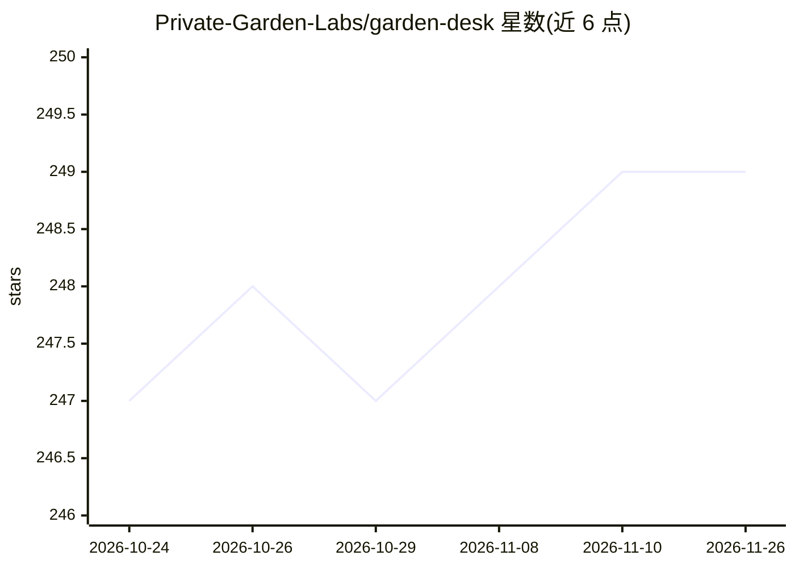

# Private-Garden-Labs/garden-desk

⭐ 249 · TypeScript · Apache-2.0 · 推送 2026-11-25 · [GitHub](https://github.com/Private-Garden-Labs/garden-desk) · [官网](https://gardendesk.ai) · 组织维护

**处理本地文件的私有桌面 AI agent，全程本地运行**

面向需要在本地处理工作文件的用户：选择文件夹或附加文件、描述所需结果、审查产出。桌面端基于 Tauri 与 React，核心为 TypeScript/Node.js；模型（Bonsai 2 27B）提出操作，Core 在无网络设备的 microVM 中运行文件工具与代码，所选文件夹只读，结果保存位置由用户决定。无账号、无遥测、无云服务。提供 Apple silicon macOS 与 Windows 11 x64 签名安装包，均需 16 GB 内存；Windows 需 12 GB VRAM GPU 且启用 Hyper-V。部分国家数据包为付费项。

## 筛选速览

| 维度 | 判定 | 备注 |
|---|---|---|
| AI 角色 | `ai-native` | 本体是模型或模型工具 |
| 许可风险 | `permissive` | Apache-2.0 |
| 部署形态 | `None` |  |
| 模型依赖 | — | README 未给出锁定关系 |
| 硬件要求 | — | 无带数字的原话,不猜 |
| 安装摩擦 | `low` | 无编译、无系统依赖或容器化 |
| 成熟度 | — | 结构信号不足 |

## 能力要点

- 本地运行，无账号、遥测或云服务
- 无网络 microVM 隔离执行文件工具与代码，源文件夹只读
- Core 提供访问控制、审批、审计与恢复机制
- 提供 macOS 与 Windows 签名安装包，可从源码构建

## 适用场景

- 在本地文件夹上让 agent 完成文档处理等任务
- 处理不可上传到云端的私有工作数据
- 在无网络隔离环境中运行文件与代码工具

## 场景标签

`AI 助手` · 领域:对话与助手

## 证据(README 行号)

> L5: Garden Desk is a free desktop agent for work with local files. Choose a folder or attach files, describe the result 
> L16:        ├─ Supervised local model (Ternary Bonsai 2 27B)
> L17:        └─ No-network microVM (virtual machine with no network device)

## 星数曲线

2026-10-24 247 → 2026-11-26 249（+2）

---
*卡片 v1 · prompt 1.4 · 生成 2026-11-25 · 置信度 high · 依据 README sha `cf8ac3266312` · [字段定义](../../DATASET.md)*
