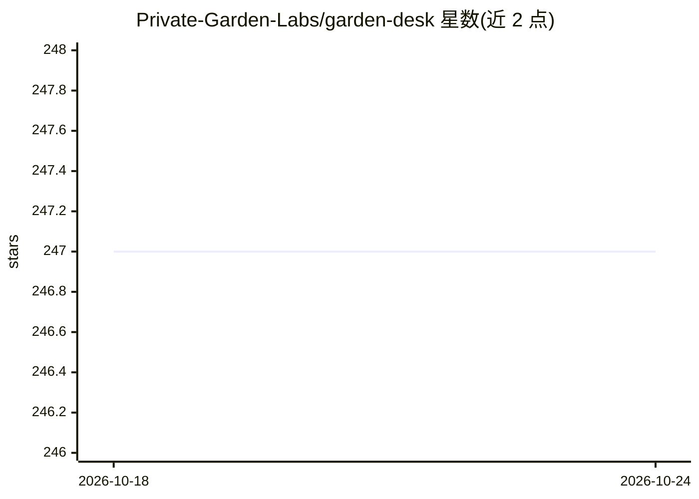

# Private-Garden-Labs/garden-desk

⭐ 247 · TypeScript · Apache-2.0 · 推送 2026-10-22 · [GitHub](https://github.com/Private-Garden-Labs/garden-desk) · [官网](https://gardendesk.ai) · 组织维护

**本地运行的桌面 AI agent：用本地模型处理私人文件工作**

基于 Tauri+React 的免费桌面 agent，用于处理本地文件：选择文件夹或附加文件、描述所需结果，由内置本地模型（Ternary Bonsai 2 27B）在无网络 microVM 中执行文件工具与代码，所选文件夹保持只读，保存位置由用户选择。无账户、无遥测、无云服务。Core 层负责文件夹访问、审批、审计与恢复。提供 Apple silicon macOS 与 Windows 11 x64 签名安装包，Windows 需 12GB VRAM 的 GPU 与 Hyper-V。

## 筛选速览

| 维度 | 判定 | 备注 |
|---|---|---|
| AI 角色 | `ai-native` | 本体是模型或模型工具 |
| 许可风险 | `permissive` | Apache-2.0 |
| 部署形态 | `None` |  |
| 模型依赖 | — | README 未给出锁定关系 |
| 硬件要求 | — | 无带数字的原话,不猜 |
| 安装摩擦 | `low` | 无编译、无系统依赖或容器化 |
| 成熟度 | — | 结构信号不足 |

## 能力要点

- 本地模型（Ternary Bonsai 2 27B）在无网络 microVM 中执行文件操作与代码
- 所选文件夹只读，结果保存位置由用户选择
- 无账户、无遥测、无云服务，全部功能免费
- Core 层提供访问控制、审批、审计与恢复机制

## 适用场景

- 在不联网、不上传文件的前提下让 AI 处理本地文档
- 对敏感工作文件做受监督的自动化处理并保留审计
- 在本地电脑上审阅 AI 提议的工作结果后选择性保存

## 场景标签

`AI 助手` · 领域:对话与助手

## 证据(README 行号)

> L5: Garden Desk is a free desktop agent for work with local files. Choose a folder or attach files, describe the result 
> L16:        ├─ Supervised local model (Ternary Bonsai 2 27B)

## 星数曲线

2026-10-18 247 → 2026-10-24 247（+0）

---
*卡片 v1 · prompt 1.4 · 生成 2026-10-22 · 置信度 high · 依据 README sha `3b1055bc6755` · [字段定义](../../DATASET.md)*
