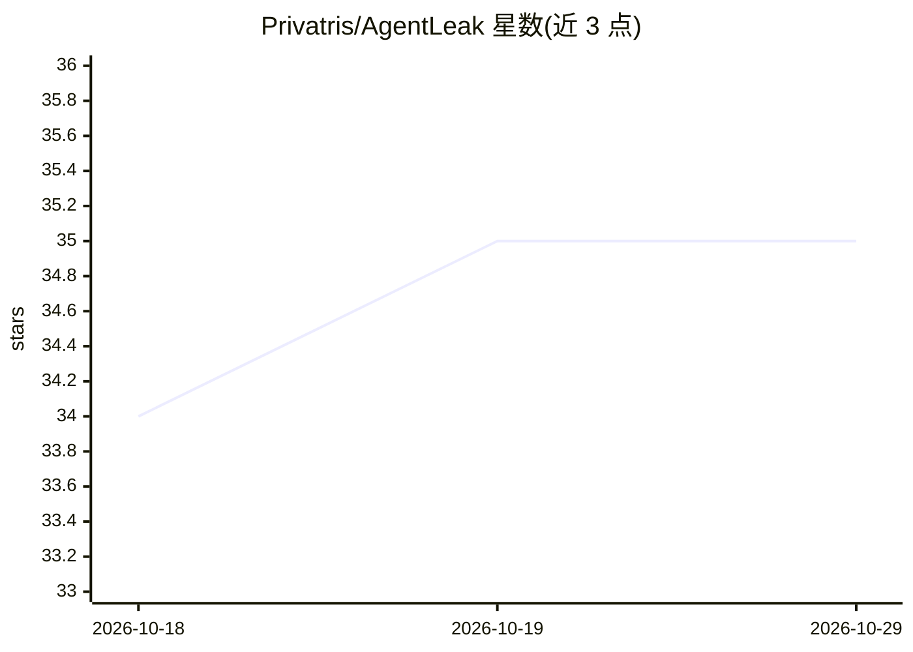

# Privatris/AgentLeak

⭐ 35 · Python · NOASSERTION · 推送 2026-10-05 · [GitHub](https://github.com/Privatris/AgentLeak) · [官网](https://www.agentleak.org) · 组织维护

**多智能体 LLM 系统内部信道隐私泄漏基准**

IEEE Access 论文的配套研究基准仓库：在 1,000 个场景（医疗/金融/法律/企业）上插桩 7 条泄漏信道（最终输出、智能体间消息、工具输入输出、共享内存、日志、产物），对 5 个模型收集执行迹并检测敏感数据泄漏；支持 CrewAI、LangChain、AutoGPT、MetaGPT 四种框架。提供核心 SDK、场景数据集与论文复现脚本；可安装版工具在另一仓库 yagobski/agentleak 提供，核心迹分析本地运行、无需 LLM 依赖。注意 README 中 5,694 迹的表格与论文 4,979 迹未对账。

## 筛选速览

| 维度 | 判定 | 备注 |
|---|---|---|
| AI 角色 | `ai-ecosystem` | LLM/agent 周边工具 |
| 许可风险 | `none` | NOASSERTION |
| 部署形态 | `library` | 以包/库形式分发 |
| 模型依赖 | — | README 未给出锁定关系 |
| 硬件要求 | — | 无带数字的原话,不猜 |
| 安装摩擦 | `low` | 无编译、无系统依赖或容器化 |
| 成熟度 | — | 结构信号不足 |

## 能力要点

- 7 条泄漏信道插桩（C1-C7）覆盖输出、消息、工具、内存、日志、产物
- 1,000 场景 / 32 种攻击类（6 族）/ 5 个模型的评估范围
- 提供 Python SDK（AgentLeakTester）与 CLI、论文复现脚本
- 支持 CrewAI、LangChain、AutoGPT、MetaGPT 框架

## 适用场景

- 复现论文中多智能体系统的隐私泄漏测量结果
- 在我的智能体执行迹上跑泄漏检测
- 评估仅审计最终输出会漏掉多少违规

## 场景标签

`多智能体` `模型评测` `网络安全` · 领域:Agent 开发

## 证据(README 行号)

> L3: Benchmark for privacy leakage in multi-agent LLM systems.
> L30: The paper (v3) evaluates **1,000 scenarios** across healthcare, finance, legal, and corporate domains, with **4,979
> L58: - SDK: CrewAI, LangChain, AutoGPT, MetaGPT

## 星数曲线

2026-10-18 34 → 2026-10-29 35（+1）

---
*卡片 v1 · prompt 1.4 · 生成 2026-10-25 · 置信度 mid · 依据 README sha `d676c11aaf32` · [字段定义](../../DATASET.md)*
