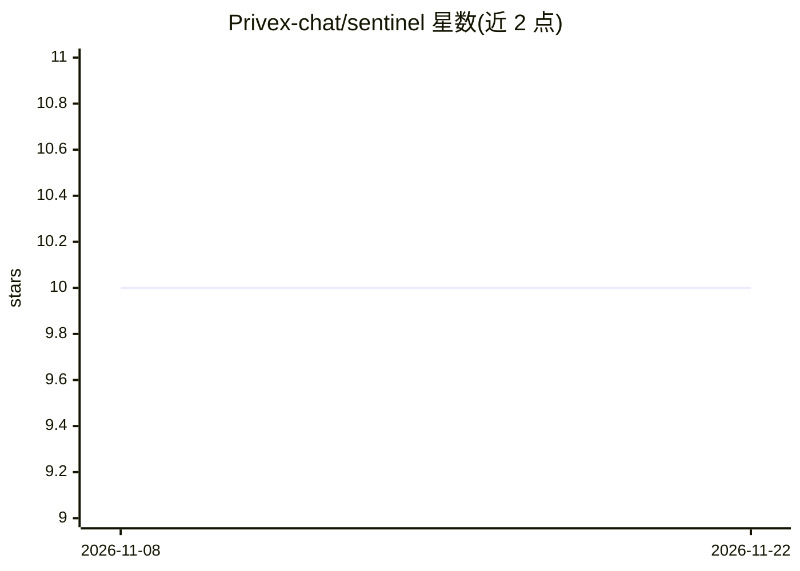

# Privex-chat/sentinel

⭐ 10 · NOASSERTION · 推送 2026-06-14 · [GitHub](https://github.com/Privex-chat/sentinel) · [官网](https://sentinel-panel.vercel.app) · 个人维护

**自托管 Discord 行为追踪与 AI 分析系统**

自托管的 Discord 情报系统：通过 Discord 网关事件（op 14 订阅）持续采集被追踪用户的状态、消息、编辑、删除、语音与互动数据，AI 对消息做分类、构建带置信度分数的社交关系图，并输出行为模式、作息热力图与异常告警。提供 Vencord 插件、Web 仪表盘、Windows 桌面安装包与远程代理等组件。各组件均为 PolyForm Noncommercial 1.0.0 许可，限非商业用途；selfbot 在普通用户账号上运行违反 Discord 服务条款。

## 筛选速览

| 维度 | 判定 | 备注 |
|---|---|---|
| AI 角色 | `ai-native` | 本体是模型或模型工具 |
| 许可风险 | `none` | NOASSERTION |
| 部署形态 | `library` | 以包/库形式分发 |
| 模型依赖 | — | README 未给出锁定关系 |
| 硬件要求 | — | 无带数字的原话,不猜 |
| 安装摩擦 | `low` | 无编译、无系统依赖或容器化 |
| 成熟度 | — | 结构信号不足 |

## 能力要点

- 基于 gateway op 14 的事件驱动实时状态追踪，含离线事件
- AI 消息分类与带置信度分数的社交关系图谱
- 按目标 IANA 时区计算作息热力图与 UNUSUAL_HOUR 告警
- 本地 SQLite 存储，可选 Supabase 加密同步

## 适用场景

- 追踪 Discord 好友的在线状态与作息规律
- 分析某用户的消息内容类别与情绪变化
- 通过 webhook 实时接收行为异常告警
- 自托管部署于 Railway 或本地运行

## 场景标签

`知识图谱` `数据分析` · 领域:效率与自动化

## 证据(README 行号)

> L18: Sentinel is a **self-hosted Discord intelligence system** that turns raw activity into meaningful insight. It watch
> L31: |🏷️ **AI Message Categorisation**|Instantly classifies messages into context-rich categories (gaming, music, ventin
> L32: |🌐 **AI Social Graph Analysis**|Maps relationships with confidence scores — close friend, romantic interest, group 

## 星数曲线

2026-11-08 10 → 2026-11-22 10（+0）

---
*卡片 v1 · prompt 1.4 · 生成 2026-11-20 · 置信度 high · 依据 README sha `10d004344775` · [字段定义](../../DATASET.md)*
