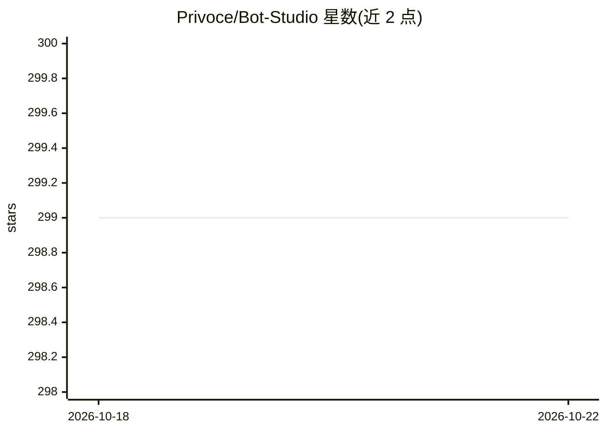

# Privoce/Bot-Studio

⭐ 299 · TypeScript · 推送 2026-01-31 · [GitHub](https://github.com/Privoce/Bot-Studio) · [官网](https://bot-studio.com) · 组织维护

**测试 OpenAI GPT 模型的开源聊天界面仪表盘**

由开发团队开源的 Web 仪表盘，提供聊天界面用于测试 OpenAI GPT API 构建的模型，以可视化对话方式替代 Python IDE 进行模型测试。使用时填入 OpenAI 的组织名、组织密钥与 API key 即可开始，当前仅支持 OpenAI GPT API。项目声明不在此应用之外使用用户填入的数据。README 中另出现两处 fine tune form 字样，未附说明细节。

## 筛选速览

| 维度 | 判定 | 备注 |
|---|---|---|
| AI 角色 | `ai-ecosystem` | LLM/agent 周边工具 |
| 许可风险 | `none` | — |
| 部署形态 | `None` |  |
| 模型依赖 | — | README 未给出锁定关系 |
| 硬件要求 | — | 无带数字的原话,不猜 |
| 安装摩擦 | `low` | 无编译、无系统依赖或容器化 |
| 成熟度 | — | 结构信号不足 |

## 能力要点

- 以聊天 UI 测试 OpenAI GPT API 模型
- 仅需填写 OpenAI 组织名、组织密钥与 API key 即可使用
- 声明用户密钥数据不在此应用之外使用

## 适用场景

- 用真实聊天界面调试 GPT 模型对话效果
- 为客户构建聊天机器人时进行模型测试

## 场景标签

`聊天机器人` `模型评测` · 领域:对话与助手

## 证据(README 行号)

> L9: developed bot-studio.com, an open sourced dashboard to test your models
> L18: Now we only support OpenAI GPT APIs. To get started, all you need is to fill our your org name, org

## 星数曲线

2026-10-18 299 → 2026-10-22 299（+0）

---
*卡片 v1 · prompt 1.4 · 生成 2026-10-21 · 置信度 mid · 依据 README sha `18edeb44f460` · [字段定义](../../DATASET.md)*
