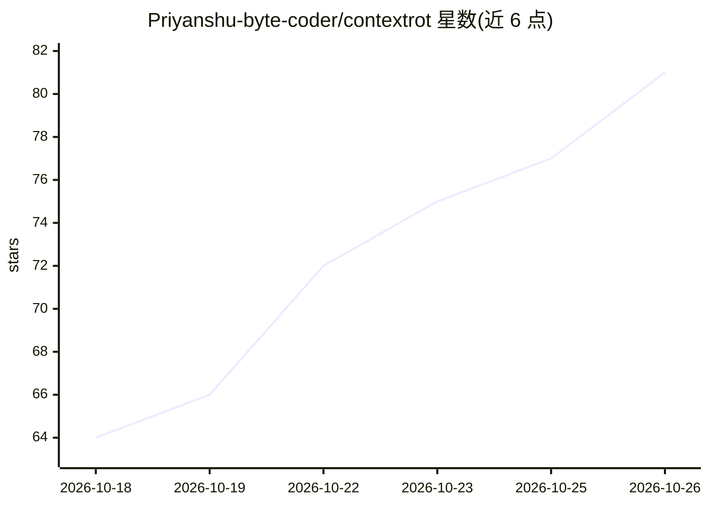

# Priyanshu-byte-coder/contextrot

⭐ 81 · Python · MIT · 推送 2026-10-11 · [GitHub](https://github.com/Priyanshu-byte-coder/contextrot) · [官网](https://priyanshu-byte-coder.github.io/contextrot/) · 个人维护

**本地分析 coding agent 会话日志，检测上下文退化趋势**

面向 coding agent 用户的 CLI 分析工具：读取 Claude Code、Codex CLI、Gemini CLI、Qwen Code 等 agent 在本地保存的会话记录，统计上下文填充程度与五类失败信号（失败编辑、重试调用、重复读文件、工具报错、道歉修正）的关系，输出四类判定（检测到退化/边缘退化/无退化/数据不足）。全流程本地运行、零网络调用、无需 API key。另提供 factors 因素排序、agents 对比、trends 趋势、tmux/Claude Code 状态栏集成等命令。Cursor 等仅部分支持（本地文件不记录逐条 token 数）。

## 筛选速览

| 维度 | 判定 | 备注 |
|---|---|---|
| AI 角色 | `ai-ecosystem` | LLM/agent 周边工具 |
| 许可风险 | `permissive` | MIT |
| 部署形态 | `library` | 以包/库形式分发 |
| 模型依赖 | — | README 未给出锁定关系 |
| 硬件要求 | — | 无带数字的原话,不猜 |
| 安装摩擦 | `low` | 无编译、无系统依赖或容器化 |
| 成熟度 | — | 结构信号不足 |

## 能力要点

- 读取 8+ 种 agent CLI 的本地会话记录，完全离线运行
- 按上下文填充度统计失败率变化，输出四类保守判定
- factors/agents/projects/trends/waste 等多维分析命令
- 状态栏实时计量（Claude Code statusline、tmux、Starship）

## 适用场景

- 验证我的 agent 是否真的随上下文变满而变差
- 找出真正影响失败率的因素（时段、模型、连续运行时长等）
- 在状态栏实时查看上下文余量与剩余轮次
- 对比不同 coding agent 在自己工作上的表现

## 场景标签

`LLM 可观测性` · 领域:评测与运维

## 证据(README 行号)

> L20: No setup, no API keys. It reads the transcripts your agent CLI already keeps, runs entirely
> L121: Agent CLIs log every step to local transcripts, with token counts and what happened. For
> L122: each step, contextrot records how full the context window was and whether one of five

## 星数曲线

2026-10-18 64 → 2026-10-26 81（+17）

---
*卡片 v1 · prompt 1.4 · 生成 2026-10-24 · 置信度 high · 依据 README sha `8fd5f1689a26` · [字段定义](../../DATASET.md)*
