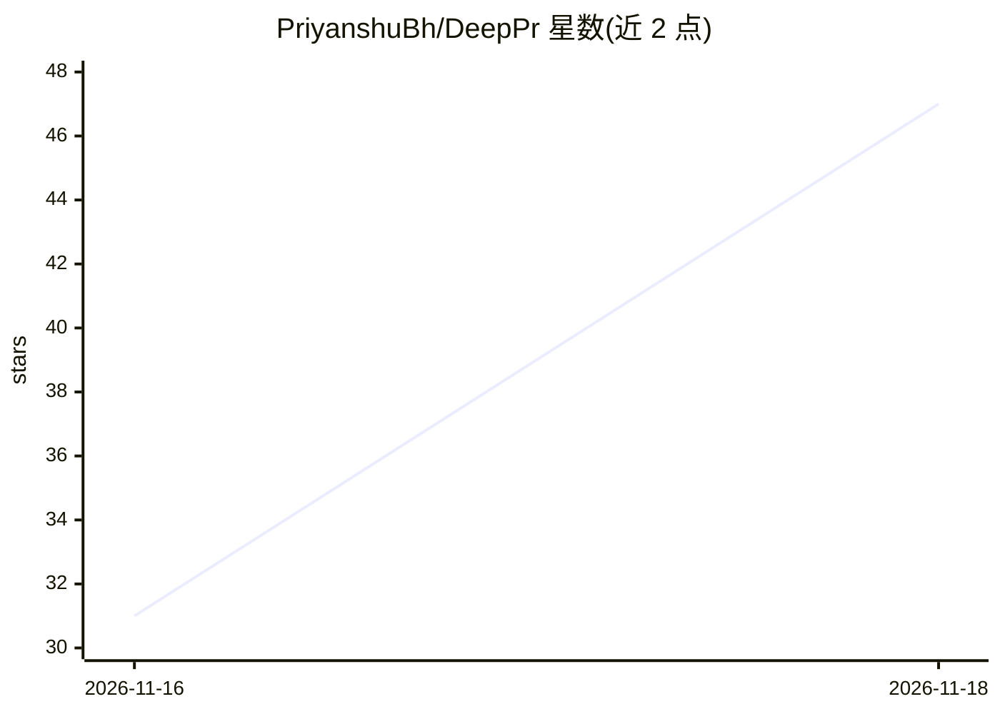

# PriyanshuBh/DeepPr

⭐ 47 · TypeScript · MIT · 推送 2026-09-29 · [GitHub](https://github.com/PriyanshuBh/DeepPr) · [官网](https://deeppr.d1i2c97iv74gio.amplifyapp.com/) · 个人维护

**GitHub PR 自动评审工具：多模型 + 向量 RAG + 持久记忆**

DeepPR 是接入 GitHub webhook 的自动化 Pull Request 评审服务：基于 AWS Lambda 与 API Gateway 的 serverless 架构，FastAPI 处理 webhook，Next.js 14 提供管理 API key 与团队规则的仪表盘。评审引擎用 LangChain 编排，Pinecone 向量 RAG 对大型 PR 分块并做语义检索，mem0 跨评审记忆团队编码偏好；可在 Amazon Bedrock (Claude 3) 与 Gemini 1.5 Flash 之间切换，并在 GitHub 上发布行内评论。需自备各服务 API key 并部署到 AWS。

## 筛选速览

| 维度 | 判定 | 备注 |
|---|---|---|
| AI 角色 | `ai-native` | 本体是模型或模型工具 |
| 许可风险 | `permissive` | MIT |
| 部署形态 | `library` | 以包/库形式分发 |
| 模型依赖 | locked-api |  |
| 硬件要求 | — | 无带数字的原话,不猜 |
| 安装摩擦 | `low` | 无编译、无系统依赖或容器化 |
| 成熟度 | — | 结构信号不足 |

## 能力要点

- Pinecone 向量 RAG 分块处理 20,000+ 行的 PR
- mem0 持久记忆团队编码约定与历史 bug 模式
- Bedrock (Claude 3) 与 Gemini 1.5 Flash 可切换
- AWS SAM serverless 部署，行内评论直接落到 GitHub 代码行

## 适用场景

- 团队希望 PR 收到自动化的行内 AI 评审
- 在大型 PR 上做分块语义检索避免 token 上限
- 积累团队编码规范供评审持续参考

## 场景标签

`代码审查` · 领域:编码与开发

## 证据(README 行号)

> L33: **DeepPR** is an advanced, automated GitHub Pull Request reviewer. It acts as an autonomous engineering teammate th
> L46:  Seamlessly switch between **Amazon Bedrock (Claude 3)** and **Google Gemini 1.5 Flash** using the Custom Instructi

## 星数曲线

2026-11-16 31 → 2026-11-18 47（+16）

---
*卡片 v1 · prompt 1.4 · 生成 2026-11-18 · 置信度 mid · 依据 README sha `88bffddeb1d6` · [字段定义](../../DATASET.md)*
