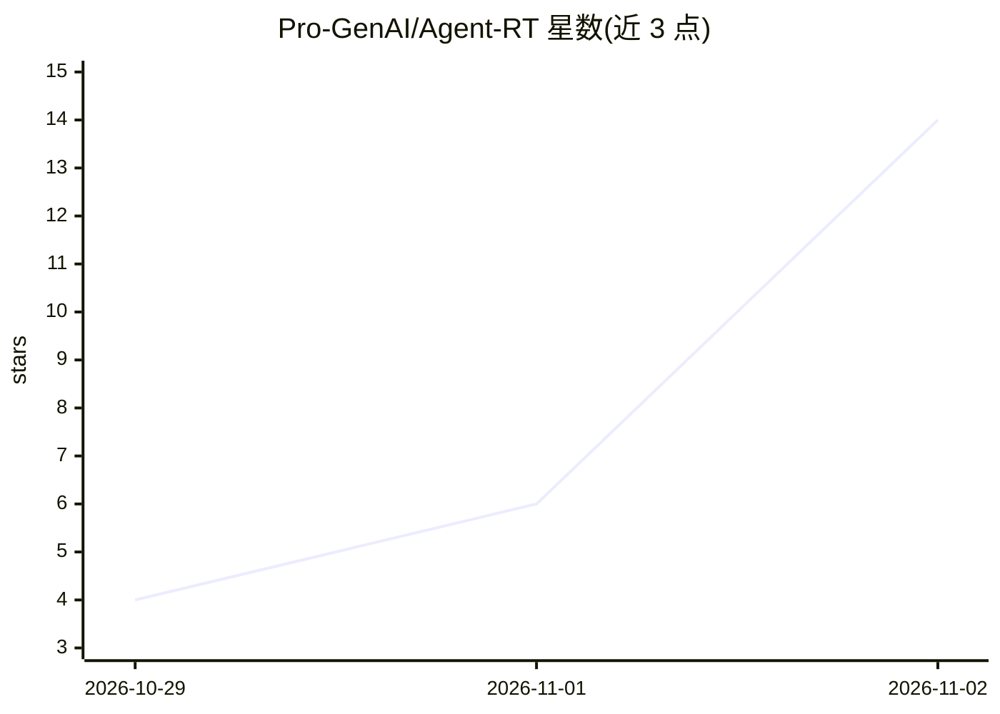

# Pro-GenAI/Agent-RT

⭐ 14 · Python · MIT · 推送 2026-11-01 · [GitHub](https://github.com/Pro-GenAI/Agent-RT) · [官网](https://agent-rt-pro.github.io/) · 组织维护

**Python/TypeScript 的轻量 AI agent 运行时，内置安全与生产控制**

面向构建生产级 AI agent 的开发者的运行时库，以 Python 与 TypeScript 双语言提供，为 agent 提供工具执行、流式输出、结构化输出、权限、审批、记忆、检查点、沙箱与可观测性等执行边界，无需重型编排框架。支持 OpenAI、Anthropic 及兼容端点，提供 CLI、Web UI 与 API 服务器；通过改一行 import 即可从 LangChain、LlamaIndex、OpenAI 等框架迁移（65+ 第三方仓库迁移后测试通过）。部分功能（API 服务器、CLI、Web UI、聊天机器人）仅 Python 提供。

## 筛选速览

| 维度 | 判定 | 备注 |
|---|---|---|
| AI 角色 | `ai-ecosystem` | LLM/agent 周边工具 |
| 许可风险 | `permissive` | MIT |
| 部署形态 | `library` | 以包/库形式分发 |
| 模型依赖 | locked-api |  |
| 硬件要求 | — | 无带数字的原话,不猜 |
| 安装摩擦 | `low` | 无编译、无系统依赖或容器化 |
| 成熟度 | — | 结构信号不足 |

## 能力要点

- 权限、审批、Guard 动作拦截、沙箱与预算检查点为运行时内置概念
- 改一行 import 即可从 LangChain/LlamaIndex/OpenAI/Anthropic 迁移，带测试回滚机制
- Python + TypeScript 双语言、供应商中立，支持兼容端点与自定义 provider
- 提供终端 CLI、Web UI、聊天机器人（beta）与决策模型控制门

## 适用场景

- 给自研 agent 套上权限、审批与沙箱等生产控制
- 从 LangChain/LlamaIndex 等框架迁移以减小安装体积与延迟
- 需要一个可跨 Python/TypeScript 复用的 agent 执行层

## 场景标签

`Agent 框架` `LLM 可观测性` · 领域:Agent 开发

## 证据(README 行号)

> L5: Agent RT gives agents a clear execution boundary for **tools, streaming, structured output, permissions, approvals, 
> L93: - 🔌 **Provider-neutral, two languages** — OpenAI, Anthropic, compatible endpoints, or custom providers, with aligne

## 星数曲线

2026-10-29 4 → 2026-11-02 14（+10）

---
*卡片 v1 · prompt 1.4 · 生成 2026-11-02 · 置信度 high · 依据 README sha `15981d1a75a4` · [字段定义](../../DATASET.md)*
