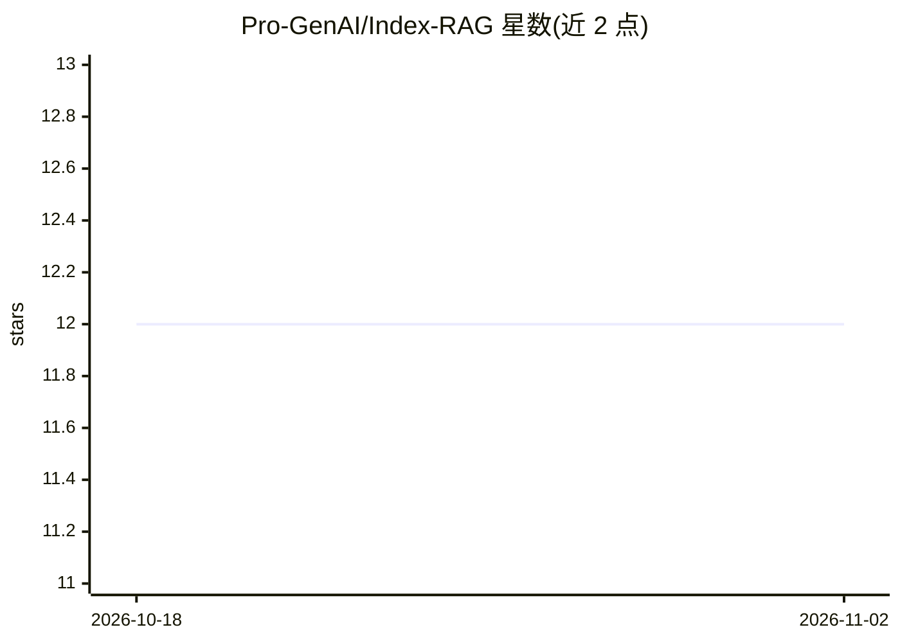

# Pro-GenAI/Index-RAG

⭐ 12 · Python · NOASSERTION · 推送 2026-03-07 · [GitHub](https://github.com/Pro-GenAI/Index-RAG) · [官网](https://www.researchgate.net/publication/397745877_Index-RAG_Storing_Text_Location_in_Vector_Databases_for_QA_tasks) · 组织维护

**在向量库中存储文本位置的引用精确 RAG 系统**

i-RAG 是一种 RAG 检索方案：对文档按段落切分，用 LLM 为每段生成多个问题，基于问题与原文生成多重嵌入，向量中仅存储文本位置元数据（文件名、页码、行号）而非重复存储全文，检索结果可给出精确引用坐标。后端使用 Pinecone 向量库与 FastAPI，提供 OpenAI 兼容 API，本地脚本托管嵌入模型。依赖 Python 3.8+、Pinecone 账号及 Cohere/OpenAI API key，通过 git clone 源码 pip 安装。

## 筛选速览

| 维度 | 判定 | 备注 |
|---|---|---|
| AI 角色 | `ai-ecosystem` | LLM/agent 周边工具 |
| 许可风险 | `none` | NOASSERTION |
| 部署形态 | `library` | 以包/库形式分发 |
| 模型依赖 | — | README 未给出锁定关系 |
| 硬件要求 | — | 无带数字的原话,不猜 |
| 安装摩擦 | `low` | 无编译、无系统依赖或容器化 |
| 成熟度 | — | 结构信号不足 |

## 能力要点

- 段落级索引与多问题嵌入，每段多个检索入口
- 向量库仅存文本位置（URL/页码/行号），避免全文重复存储
- OpenAI 兼容 API，可替换现有应用的接入方式
- 提供评测脚本（precision/mrr/ndcg）与基线对比结果

## 适用场景

- 法律、合规场景需要给出精确出处的问答
- 学术与医学文献检索时标注引用坐标
- 为已有 RAG 应用增加可审计的来源追踪

## 场景标签

`RAG` `文档问答` · 领域:知识与检索

## 证据(README 行号)

> L3: # Index-RAG (i-RAG): Storing Text Location in Vector Databases for QA tasks
> L32: We store multiple embeddings per paragraph based on AI-generated questions and the original paragraph text. If each

## 星数曲线

2026-10-18 12 → 2026-11-02 12（+0）

---
*卡片 v1 · prompt 1.4 · 生成 2026-11-01 · 置信度 mid · 依据 README sha `0d6b4370b096` · [字段定义](../../DATASET.md)*
