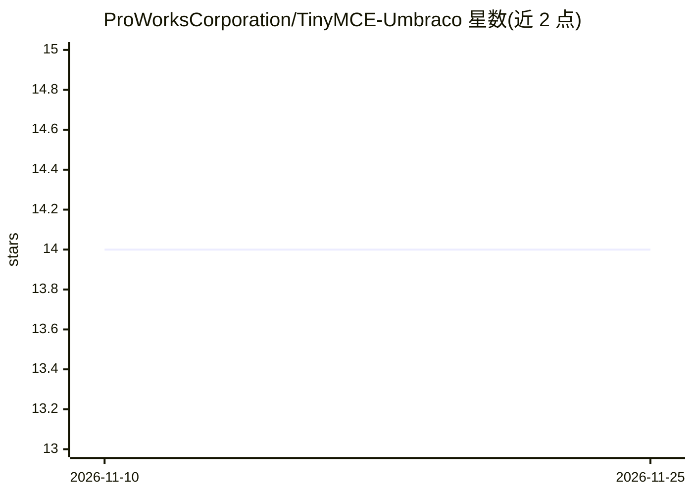

# ProWorksCorporation/TinyMCE-Umbraco

⭐ 14 · TypeScript · NOASSERTION · 推送 2026-11-19 · [GitHub](https://github.com/ProWorksCorporation/TinyMCE-Umbraco) · 组织维护

**为 Umbraco CMS 16+ 恢复 TinyMCE 富文本编辑器**

一个 Umbraco CMS 包，把 TinyMCE 富文本编辑器带回 Umbraco 16 及以上版本（本版本要求 Umbraco 18.3.0+），支持配置 RTE Data Type、通过 appsettings.json 进行 JSON 配置，并可阻止 Umbraco 默认 TipTap 编辑器转换。持有 Tiny 订阅可启用 Premium 插件；配置 openAiApikey 后提供编辑器内 AI 助手，请求经服务端代理转发 OpenAI，密钥不进浏览器。默认捆绑 TinyMCE 6.8.x 核心，README 列出其已知 XSS 公告与升级到 7/8 的步骤。

## 筛选速览

| 维度 | 判定 | 备注 |
|---|---|---|
| AI 角色 | `ai-enhanced` | 去掉 AI 部分产品仍成立 |
| 许可风险 | `none` | NOASSERTION |
| 部署形态 | `desktop` | 安装包/桌面程序 |
| 模型依赖 | — | README 未给出锁定关系 |
| 硬件要求 | — | 无带数字的原话,不猜 |
| 安装摩擦 | `medium` | 含编译或系统依赖之一 |
| 成熟度 | — | 结构信号不足 |

## 能力要点

- 通过 appsettings.json/.NET 配置直接管理 RTE Data Type 与插件
- openAiApikey 配置后启用编辑器内 AI 助手，API key 保留在服务端
- 支持 Tiny Cloud 或自托管 TinyMCE 库 URL，并可切换 TinyMCE 7/8
- 列出捆绑 TinyMCE 6.8.x 已知 XSS 安全公告及对应修复版本

## 适用场景

- Umbraco 16+ 站点恢复 TinyMCE 富文本编辑器
- 从 Umbraco 15 升级时阻止转换为 TipTap 编辑器
- 在编辑器中启用 OpenAI 驱动的 AI 助手且密钥不出服务器
- 通过 JSON 配置统一管理全站编辑器插件与工具栏

## 场景标签

 · 领域:CMS/内容编辑工具

## 证据(README 行号)

> L7: This package brings the TinyMCE Rich Text Editor (RTE) back to Umbraco CMS. This version requires Umbraco 18.3.0 or 
> L9: It also supports the use of TinyMCE Premium plugins with a valid subscription. Additional features include streamlin
> L119: |openAiApikey|key string|None|The ChatGPT API Key found in your account. This will enable a default implementation
> L161: **The OpenAI key stays on the server.** The AI assistant sends each request to this package's own back-office endp

## 星数曲线

2026-11-10 14 → 2026-11-25 14（+0）

---
*卡片 v1 · prompt 1.4 · 生成 2026-11-18 · 置信度 mid · 依据 README sha `3ee2c7bf3065` · [字段定义](../../DATASET.md)*
