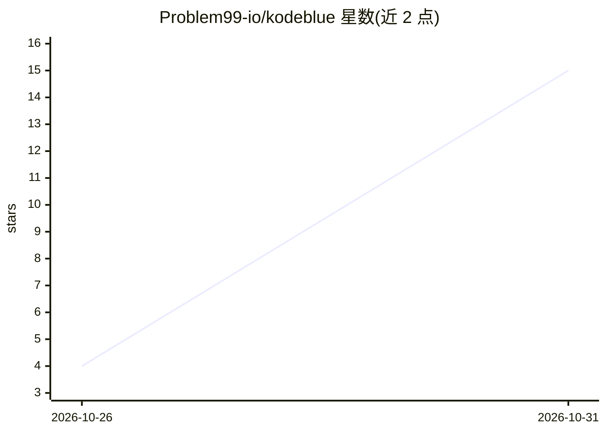

# Problem99-io/kodeblue

⭐ 15 · Go · Apache-2.0 · 推送 2026-10-30 · [GitHub](https://github.com/Problem99-io/kodeblue) · 组织维护

**每台 Linux 服务器一个防御 agent：SOC、事件响应与 SecOps**

以非 root 用户常驻每台 Linux 服务器的安全 agent：通过快照与探索学习主机常态，5 秒轮询敏感文件变化，确定性传感器与过滤器零 token 消耗，仅将过滤后的事件交给小型 OpenAI 兼容模型分诊；每个事件开独立 agent 会话调查并给出裁决，经 root helper 在策略允许时执行封禁/隔离等处置（默认 recommend 模式需人工批准），并每日自调优检测规则、向 Slack 汇报。支持多服务器接入可选 hub 控制台。未配置模型时传感器与检测仍可运行。

## 筛选速览

| 维度 | 判定 | 备注 |
|---|---|---|
| AI 角色 | `ai-native` | 本体是模型或模型工具 |
| 许可风险 | `permissive` | Apache-2.0 |
| 部署形态 | `self-host` | docker 或自建部署 |
| 模型依赖 | local-ok | 支持本地模型 |
| 硬件要求 | — | 无带数字的原话,不猜 |
| 安装摩擦 | `low` | 无编译、无系统依赖或容器化 |
| 成熟度 | — | 结构信号不足 |

## 能力要点

- 确定性传感器+过滤器零 token 前置过滤，小模型仅分诊残留事件
- 每事件独立 agent 会话调查，输出可逐步阅读的裁决
- 经 root helper 执行可撤销的遏制动作，管理员账户不被触碰
- 可选 hub 汇聚多服务器的事件、报告与 agent 推理过程

## 适用场景

- 让无人值守的 Linux 服务器获得持续安全监控与响应
- 小团队用小模型低成本替代 24/7 安全值守
- 运维通过 Slack 收到告警并审批 agent 的遏制建议

## 场景标签

`网络安全` · 领域:学习与行业

## 证据(README 行号)

> L13: **An AI blue team for your Linux servers: SOC, incident response and SecOps in one.** One kodeblue per server, runn
> L18: It is built to run on a small, cheap model behind any OpenAI-compatible API: deterministic sensors and filters do t

## 星数曲线

2026-10-26 4 → 2026-10-31 15（+11）

---
*卡片 v1 · prompt 1.4 · 生成 2026-10-31 · 置信度 mid · 依据 README sha `c34d7bb59d92` · [字段定义](../../DATASET.md)*
