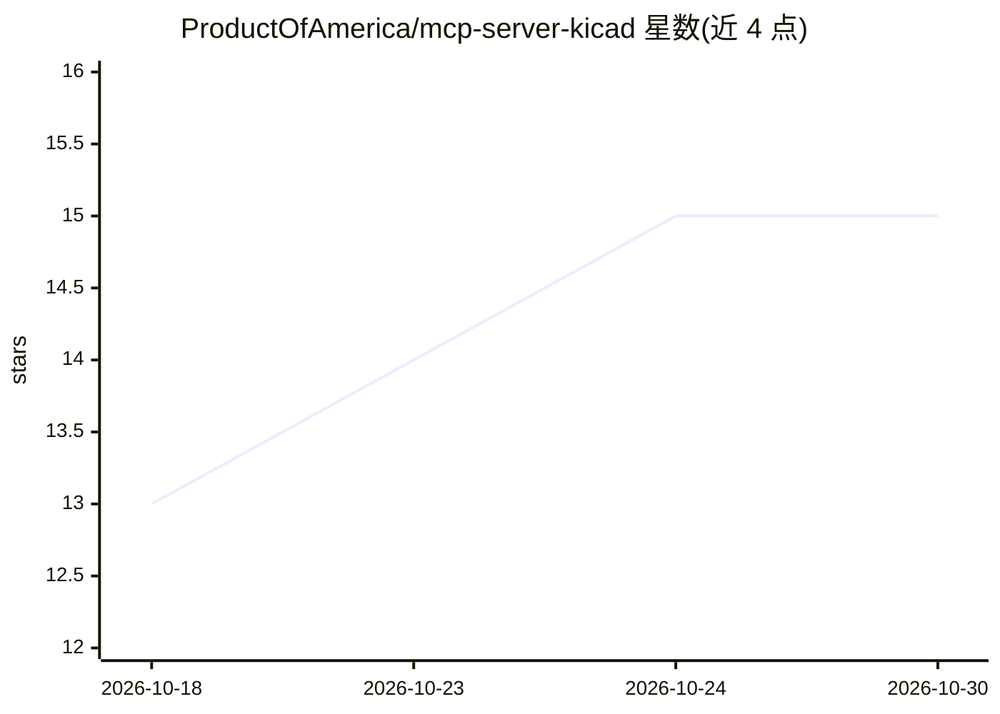

# ProductOfAmerica/mcp-server-kicad

⭐ 15 · Python · GPL-3.0 · 推送 2026-10-29 · [GitHub](https://github.com/ProductOfAmerica/mcp-server-kicad) · [官网](https://pypi.org/project/mcp-server-kicad) · 个人维护

**让 AI 助手通过 MCP 工具编辑 KiCad 项目的服务器（109 工具）**

KiCad 的 Model Context Protocol 服务器：提供 109 个工具覆盖原理图绘制、PCB 布局、符号/封装库、ERC/DRC 检查与制造文件导出（Gerber、BOM、3D），模型调用工具即改变磁盘上的 KiCad 文件。可整体运行或拆分为五个工具服务器，附六个 Claude Code 设计技能与审查子代理。处于维护模式：自 2026 年 10 月起仅接受安全与 KiCad 兼容性修复，不再新增功能。要求 Python 3.11+，部分工具需 KiCad 9.x/10.x，自动布线需 Java 25+ 并下载 Freerouting。

## 筛选速览

| 维度 | 判定 | 备注 |
|---|---|---|
| AI 角色 | `ai-ecosystem` | LLM/agent 周边工具 |
| 许可风险 | `viral` | GPL-3.0 |
| 部署形态 | `library` | 以包/库形式分发 |
| 模型依赖 | — | README 未给出锁定关系 |
| 硬件要求 | — | 无带数字的原话,不猜 |
| 安装摩擦 | `medium` | 含编译或系统依赖之一 |
| 成熟度 | — | 结构信号不足 |

## 能力要点

- 109 个 MCP 工具覆盖原理图/PCB/库/ERC/DRC/制造导出，分五个可独立运行的服务器
- 写入只改动请求的字节，无法正确完成的编辑会被拒绝且文件保持原样
- 六个 Claude Code 设计技能配合独立审查子代理
- Freerouting 自动布线：下载时校验 SHA-256，可用 FREEROUTING_JAR 指定本地 jar

## 适用场景

- 让 Claude 等 MCP 客户端直接读写我的 KiCad 工程文件
- 通过 AI 助手完成原理图修改、布局并跑 ERC/DRC 验证
- 从 KiCad 项目导出 Gerber、BOM、3D 模型等制造文件

## 场景标签

 · 领域:电子设计自动化（EDA）/开发工具

## 证据(README 行号)

> L5: **Let an AI assistant edit real KiCad projects without corrupting them.**
> L7: 109 MCP tools covering schematic capture, PCB layout, symbol and footprint
> L98: That single entry registers all 109 tools. A client that starts the server in

## 星数曲线

2026-10-18 13 → 2026-10-30 15（+2）

---
*卡片 v1 · prompt 1.4 · 生成 2026-10-30 · 置信度 mid · 依据 README sha `29acfa70b659` · [字段定义](../../DATASET.md)*
