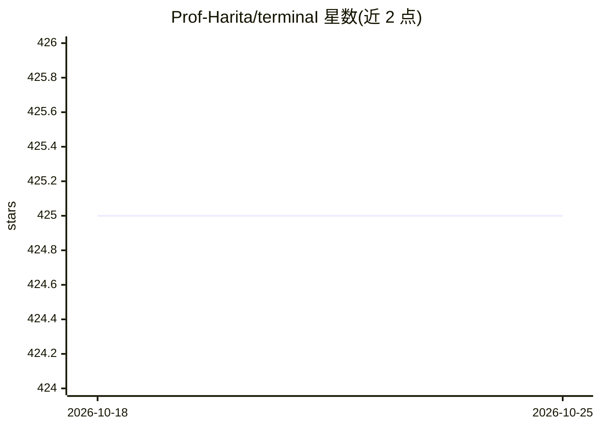

# Prof-Harita/terminaI

⭐ 425 · TypeScript · Apache-2.0 · 推送 2026-10-21 · [GitHub](https://github.com/Prof-Harita/terminaI) · [官网](https://terminai.org/) · 个人维护

**本地优先的受治理终端 AI 操作器：意图→计划→审批→执行→审计**

基于 CLI 的 AI 系统操作器：用户描述意图，它检查机器、提出计划，经 A/B/C 级审批阶梯后通过治理工具执行，并写入 JSONL 审计日志。核心机制为三层防御：多模型共识的 PAC 循环、确定性策略引擎、AppContainer/MicroVM 沙箱隔离。通过 node-pty 提供真实 PTY 支持（sudo/ssh/vim 等交互流）。模型可选 Gemini、ChatGPT OAuth 登录、OpenAI 兼容端点（含 OpenRouter 与本地网关）。CLI 为主要界面，Desktop/Voice 为预览状态，npm 全局安装，需 Node.js 20+。

## 筛选速览

| 维度 | 判定 | 备注 |
|---|---|---|
| AI 角色 | `ai-native` | 本体是模型或模型工具 |
| 许可风险 | `permissive` | Apache-2.0 |
| 部署形态 | `library` | 以包/库形式分发 |
| 模型依赖 | — | README 未给出锁定关系 |
| 硬件要求 | — | 无带数字的原话,不猜 |
| 安装摩擦 | `medium` | 含编译或系统依赖之一 |
| 成熟度 | `idea` | |

## 能力要点

- 真实 PTY 终端操作（sudo/ssh/vim 等交互式流程）
- A/B/C 审批阶梯 + 策略引擎 + JSONL 审计日志
- AppContainer（Windows）/MicroVM OS 级沙箱隔离
- 模型无关：Gemini、ChatGPT OAuth、任意 OpenAI 兼容端点

## 适用场景

- 让 AI 在受审批约束下修复驱动、清理磁盘、配置开发环境
- 通过交互式终端远程运维服务器并留审计痕迹
- 本地或 OpenRouter 免费模型上运行，零遥测

## 场景标签

`工作流自动化` · 领域:效率与自动化

## 证据(README 行号)

> L18: **TerminAI is an AI-powered system operator.**
> L32: - A **local-first operator runtime**: intent → governed plan → approvals →
> L138: - **True PTY support:** handles interactive applications correctly (sudo

## 星数曲线

2026-10-18 425 → 2026-10-25 425（+0）

---
*卡片 v1 · prompt 1.4 · 生成 2026-10-21 · 置信度 high · 依据 README sha `0a234137ab4e` · [字段定义](../../DATASET.md)*
