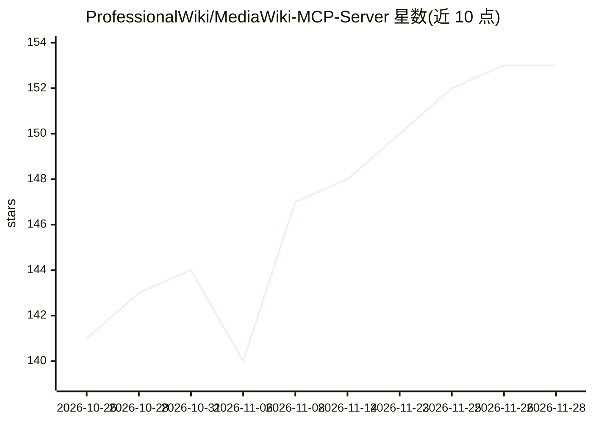

# ProfessionalWiki/MediaWiki-MCP-Server

⭐ 153 · TypeScript · MIT · 推送 2026-11-26 · [GitHub](https://github.com/ProfessionalWiki/MediaWiki-MCP-Server) · [官网](https://professional.wiki/en/mediawiki-mcp-server) · 组织维护

**连接 LLM 客户端与任意 MediaWiki 的 MCP 服务器**

一个 MCP（Model Context Protocol）服务器，让支持 MCP 的 LLM 客户端读取和操作任意 MediaWiki 站点。提供页面读取（搜索、历史、差异、随机页、最近更改、站点信息）、页面写入（创建/编辑/删除/移动/保护、文件上传）等工具，支持多 wiki 配置与动态添加/移除 wiki，带 OAuth 浏览器认证。对装有特定扩展（NeoWiki、Semantic MediaWiki、Cargo、Bucket、Wikibase）的 wiki 提供扩展工具包。写入工具在只读 wiki 上被拒绝，需认证的工具标记 🔐。

## 筛选速览

| 维度 | 判定 | 备注 |
|---|---|---|
| AI 角色 | `ai-ecosystem` | LLM/agent 周边工具 |
| 许可风险 | `permissive` | MIT |
| 部署形态 | `library` | 以包/库形式分发 |
| 模型依赖 | — | README 未给出锁定关系 |
| 硬件要求 | — | 无带数字的原话,不猜 |
| 安装摩擦 | `low` | 无编译、无系统依赖或容器化 |
| 成熟度 | — | 结构信号不足 |

## 能力要点

- 20+ 页面读取工具与 11 个写入工具，覆盖搜索、差异、历史、上传
- 支持配置多个 wiki，工具可用 wiki 参数切换目标站点
- 扩展工具包：NeoWiki/Semantic MediaWiki/Cargo/Bucket/Wikibase 的专属查询与编辑工具
- stdio/http 双传输、浏览器 OAuth 认证、每响应字节上限等可调环境变量

## 适用场景

- 让 Claude Code/Cursor 等客户端直接查询和编辑 MediaWiki 页面
- 对 Semantic MediaWiki/Wikibase 类知识库做结构化查询
- 私有 wiki 的认证读写接入

## 场景标签

`知识库管理` · 领域:知识与检索

## 证据(README 行号)

> L4: An MCP (Model Context Protocol) server that enables Large Language Model (LLM) clients to interact with any MediaWik
> L149: |`MCP_TRANSPORT`|Type of MCP server transport (`stdio` or `http`)|`stdio`|

## 星数曲线

2026-10-26 141 → 2026-11-28 153（+12）

---
*卡片 v1 · prompt 1.4 · 生成 2026-11-27 · 置信度 high · 依据 README sha `29f4eaadd372` · [字段定义](../../DATASET.md)*
