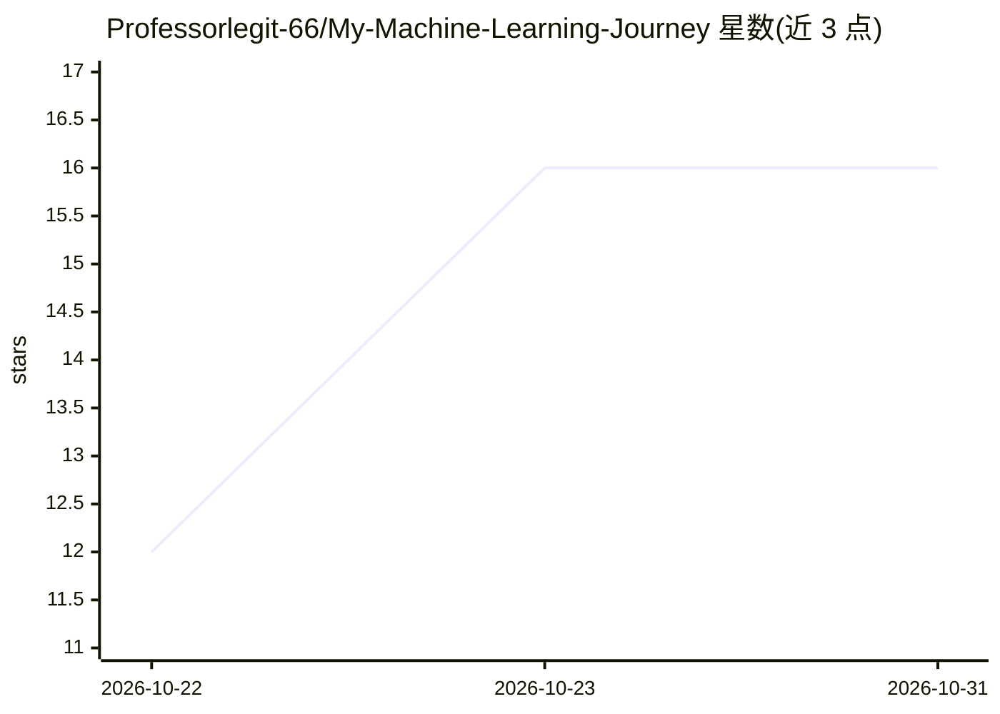

# Professorlegit-66/My-Machine-Learning-Journey

⭐ 16 · Jupyter Notebook · 推送 2026-10-30 · [GitHub](https://github.com/Professorlegit-66/My-Machine-Learning-Journey) · 个人维护

**个人机器学习学习记录仓库：笔记本、实验与从零实现**

个人 ML 学习过程的结构化记录仓库：按阶段组织文件夹（100 Days of ML 等），内容涵盖数据收集、EDA、特征工程（变换/构造/提取/选择）、模型开发与评估，强调动手实践与从零实现算法，以 Jupyter 笔记本与实验形式呈现。技术栈为 Python、NumPy、Pandas、Scikit-learn 与多种可视化库。README 未提供安装命令或产品化入口，仓库自身声明为持续更新的学习记录。

## 筛选速览

| 维度 | 判定 | 备注 |
|---|---|---|
| AI 角色 | `ai-knowledge` | 知识聚合/清单类 |
| 许可风险 | `none` | — |
| 部署形态 | `None` |  |
| 模型依赖 | — | README 未给出锁定关系 |
| 硬件要求 | — | 无带数字的原话,不猜 |
| 安装摩擦 | `low` | 无编译、无系统依赖或容器化 |
| 成熟度 | `idea` | |

## 能力要点

- 按学习阶段组织的笔记本与实验目录结构
- 特征工程链条（变换/构造/提取/选择）各阶段记录
- 包含算法从零实现与模型开发实践

## 适用场景

- 参考他人 ML 学习路径与阶段划分
- 查找特征工程与 EDA 的实践笔记本示例
- 了解从零实现 ML 算法的练习方式

## 场景标签

`教程课程` · 领域:学习与行业

## 证据(README 行号)

> L3: A structured, hands-on record of my journey into **Machine Learning** — from data gathering and exploratory analysis
> L9: This repository documents my progress as I work through Machine Learning concepts, one topic at a time.

## 星数曲线

2026-10-22 12 → 2026-10-31 16（+4）

---
*卡片 v1 · prompt 1.4 · 生成 2026-10-30 · 置信度 high · 依据 README sha `eb8d438d8dda` · [字段定义](../../DATASET.md)*
