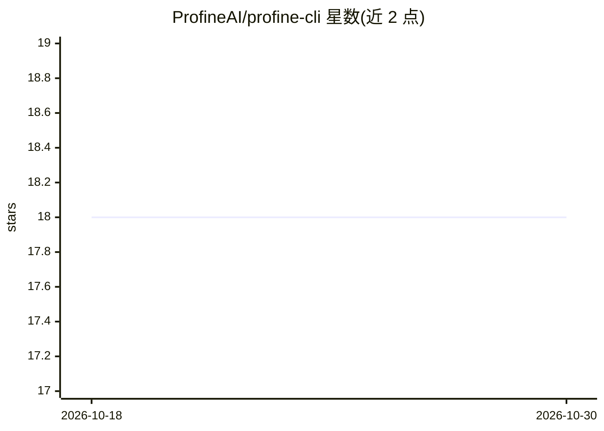

# ProfineAI/profine-cli

⭐ 18 · Python · Apache-2.0 · 推送 2026-05-20 · [GitHub](https://github.com/ProfineAI/profine-cli) · [官网](https://profine.ai) · 组织维护

**CLI 工具：在真实 GPU 上自动剖析并优化 PyTorch 训练脚本**

面向 PyTorch 用户的训练性能优化 CLI：流水线为 read→profile→interpret→suggest→edit→benchmark，通过 AST+LLM 读取脚本结构，在 Modal 云端 GPU 上以 torch.profiler 剖析，再由 LLM 从优化目录中筛选、排序并自动改写代码，最终在相同硬件上对比基准与优化后的运行结果（含损失曲线正确性校验）。支持 OpenAI/Anthropic 或任意 OpenAI 兼容本地服务作为 LLM 后端，本地模型建议 70B 级以上。限制：需要 Modal 账户，硬件预设限于 T4/L4/A10G/A100/H100。

## 筛选速览

| 维度 | 判定 | 备注 |
|---|---|---|
| AI 角色 | `ai-ecosystem` | LLM/agent 周边工具 |
| 许可风险 | `permissive` | Apache-2.0 |
| 部署形态 | `library` | 以包/库形式分发 |
| 模型依赖 | local-ok | 支持本地模型 |
| 硬件要求 | — | 无带数字的原话,不猜 |
| 安装摩擦 | `low` | 无编译、无系统依赖或容器化 |
| 成熟度 | — | 结构信号不足 |

## 能力要点

- 六阶段流水线 run-all 一条命令完成剖析到基准验证
- 自动改写多文件代码且不触碰源码树，补丁落在输出目录
- BF16/TF32/torch.compile/SDPA 等优化可叠加，回归时自动剥离重测
- 基准报告含 p25/p50/p75 与置信区间，损失容差随数值扰动自动放宽

## 适用场景

- 训练脚本上 GPU 前先自动定位瓶颈并拿到实测加速
- 不想手工调混合精度/compile 配置的团队自动完成优化栈
- 用本地 LLM（Ollama/vLLM）驱动剖析与改写流程

## 场景标签

`MLOps` · 领域:训练与推理

## 证据(README 行号)

> L87: read → profile → interpret → suggest → edit → benchmark
> L141: Reads model/optimizer/dataloader/precision/distributed-strategy facts via AST + LLM, plus any local modules the sc

## 星数曲线

2026-10-18 18 → 2026-10-30 18（+0）

---
*卡片 v1 · prompt 1.4 · 生成 2026-10-29 · 置信度 high · 依据 README sha `17492898cb9d` · [字段定义](../../DATASET.md)*
