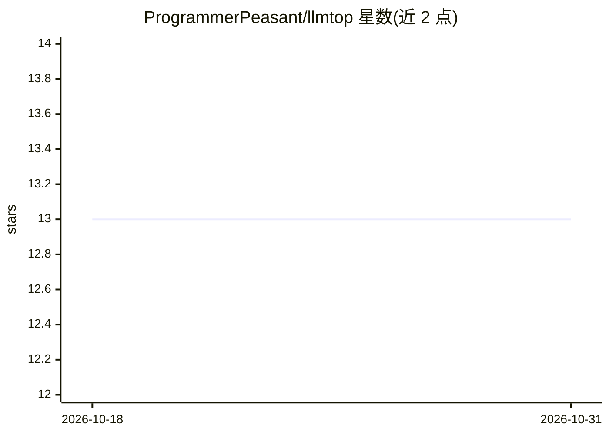

# ProgrammerPeasant/llmtop

⭐ 13 · Rust · MIT · 推送 2026-06-05 · [GitHub](https://github.com/ProgrammerPeasant/llmtop) · 个人维护

**终端 GPU 监控器：关联本地 LLM 服务与功耗/成本指标**

Rust 编写的终端 TUI GPU 监控工具，面向本地 LLM 服务器运维：读取 NVML/IOReport 获取 GPU 利用率、显存、功耗与温度，通过 Ollama /api/ps 识别已加载模型并计算每模型显存占用；默认运行反向代理（:11435）转发请求，从响应中的 eval_count/eval_duration 解析实时 tokens/s，进而计算每 token 焦耳、会话 kWh 与 CO2、按托管 API 价格表折算等效美元成本。支持 Linux/Windows，macOS Apple Silicon 列为 v0.2 计划。经 cargo 安装。

## 筛选速览

| 维度 | 判定 | 备注 |
|---|---|---|
| AI 角色 | `ai-ecosystem` | LLM/agent 周边工具 |
| 许可风险 | `permissive` | MIT |
| 部署形态 | `library` | 以包/库形式分发 |
| 模型依赖 | local-ok | 支持本地模型 |
| 硬件要求 | — | 无带数字的原话,不猜 |
| 安装摩擦 | `low` | 无编译、无系统依赖或容器化 |
| 成熟度 | — | 结构信号不足 |

## 能力要点

- 识别 Ollama 已加载模型并计算每模型显存占用
- 反向代理解析实时 tokens/s，计算 J/token
- 会话 kWh、CO2（可设电网碳强度）与 API 等效成本
- 与 nvtop/nvitop/asitop 的功能对照表

## 适用场景

- 本地跑 Ollama 时查看 GPU 功耗与每 token 能耗/成本
- 比较多 GPU 或远程服务器上的 LLM 推理开销
- 估算本地推理相对托管 API 的费用差

## 场景标签

`LLM 可观测性` · 领域:评测与运维

## 证据(README 行号)

> L7: Terminal GPU monitor that links wattage to the LLM burning it. Tells you VRAM share, joules per token, hosted-API eq
> L64: |Loaded models, per-model VRAM|Ollama `/api/ps`|
> L65: |Tokens/sec live|Reverse proxy parses `eval_count` / `eval_duration` from `/api/generate` and `/api/chat`|

## 星数曲线

2026-10-18 13 → 2026-10-31 13（+0）

---
*卡片 v1 · prompt 1.4 · 生成 2026-10-31 · 置信度 high · 依据 README sha `0e4c735030e7` · [字段定义](../../DATASET.md)*
