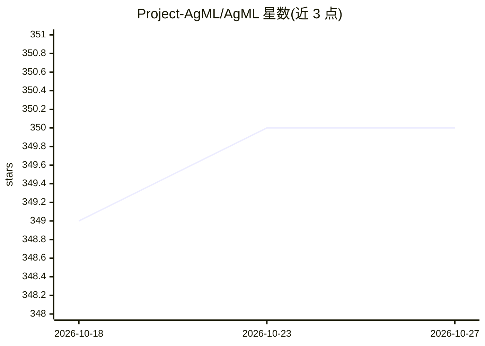

# Project-AgML/AgML

⭐ 350 · Python · Apache-2.0 · 推送 2026-10-22 · [GitHub](https://github.com/Project-AgML/AgML) · [官网](https://project-agml.github.io) · 组织维护

**农业机器学习库：统一访问公共农业数据集与标准标注**

面向农业深度学习开发者的 Python 库：通过 HuggingFaceDataLoader 与 AgMLDataLoader 提供公共农业数据集（含 400 万张图像的 iNatAg）的下载、加载与训练/验证/测试划分，覆盖图像分类、目标检测、语义分割任务，标注以 DatasetDict 列形式标准化（ClassLabel、COCO 风格框、单通道 mask）。支持 PyTorch 与 TensorFlow，预处理与训练直接使用 datasets/transformers 库，无 AgML 专属 API。另提供 zip 分片大图像文本数据集的惰性解码与有界缓存机制。

## 筛选速览

| 维度 | 判定 | 备注 |
|---|---|---|
| AI 角色 | `ai-ecosystem` | LLM/agent 周边工具 |
| 许可风险 | `permissive` | Apache-2.0 |
| 部署形态 | `library` | 以包/库形式分发 |
| 模型依赖 | — | README 未给出锁定关系 |
| 硬件要求 | — | 无带数字的原话,不猜 |
| 安装摩擦 | `low` | 无编译、无系统依赖或容器化 |
| 成熟度 | — | 结构信号不足 |

## 能力要点

- HuggingFaceDataLoader/AgMLDataLoader 加载公共农业数据集并自动划分
- iNatAg 数据集（超 400 万图像）按科名/俗名过滤访问
- 标注格式标准化：ClassLabel、COCO 风格边界框、单通道分割 mask
- loadImageTextToTextDataset 惰性解码 zip 分片大数据集，带 256 MiB 默认缓存

## 适用场景

- 下载并加载农业图像数据集训练分类/检测/分割模型
- 按物种过滤访问 iNatAg 大规模农业图像数据
- 将多个农业数据集整合进统一训练流水线

## 场景标签

 · 领域:农业/机器学习

## 证据(README 行号)

> L8: AgML is a comprehensive library for agricultural machine learning. Currently, AgML provides
> L49: **For any preprocessing, inference, or training beyond loading and splitting, use the

## 星数曲线

2026-10-18 349 → 2026-10-27 350（+1）

---
*卡片 v1 · prompt 1.4 · 生成 2026-10-21 · 置信度 high · 依据 README sha `c40afaef1ac5` · [字段定义](../../DATASET.md)*
