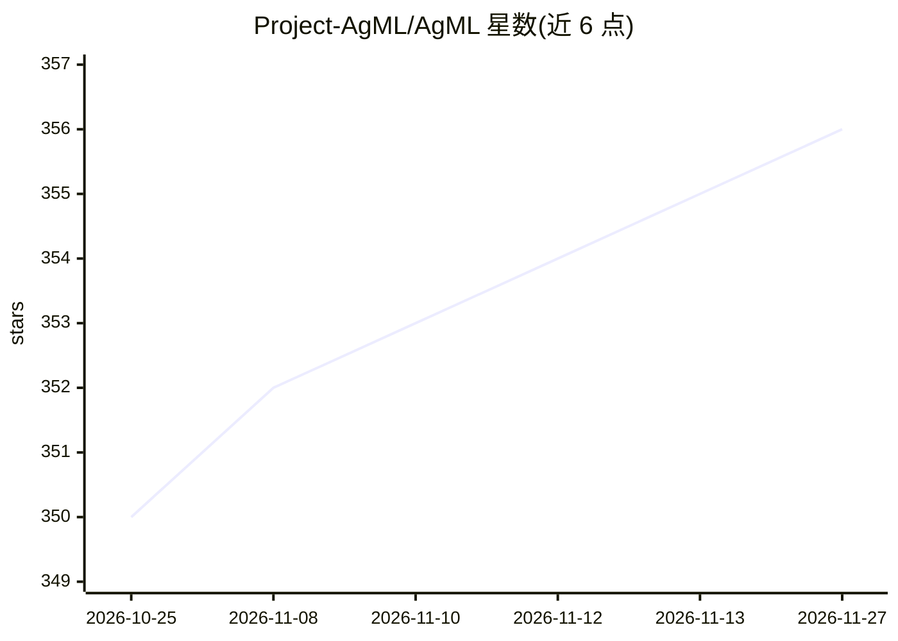

# Project-AgML/AgML

⭐ 356 · Python · Apache-2.0 · 推送 2026-11-24 · [GitHub](https://github.com/Project-AgML/AgML) · [官网](https://project-agml.github.io) · 组织维护

**面向农业机器学习研究者/开发者的数据集与基准框架**

AgML 是一个农业机器学习库，核心是提供公开农业深度学习数据集的统一访问：通过 HuggingFaceDataLoader/AgMLDataLoader 下载并加载为 DatasetDict，支持按列分层切分 train/val/test，标注以标准化列格式编码（分类/检测/分割）。另提供 USDA NASS 与加州产量基准等农业统计数据查询模块（按数据源装 extras），支持 TensorFlow 与 PyTorch。预处理、训练、推理需直接使用 datasets/transformers，库本身不提供单独的处理 API。

## 筛选速览

| 维度 | 判定 | 备注 |
|---|---|---|
| AI 角色 | `ai-ecosystem` | LLM/agent 周边工具 |
| 许可风险 | `permissive` | Apache-2.0 |
| 部署形态 | `library` | 以包/库形式分发 |
| 模型依赖 | — | README 未给出锁定关系 |
| 硬件要求 | — | 无带数字的原话,不猜 |
| 安装摩擦 | `low` | 无编译、无系统依赖或容器化 |
| 成熟度 | — | 结构信号不足 |

## 能力要点

- 公开农业数据集的统一下载与加载（AgMLDataLoader/HuggingFaceDataLoader）
- 标准化标注格式：ClassLabel 标签、COCO 式边界框、单通道分割 mask
- USDA NASS 与加州产量基准统计数据查询，输出 pandas/polars/arrow/csv/parquet
- 支持 TensorFlow 与 PyTorch 两个框架

## 适用场景

- 下载并标准化加载农业图像分类/检测/分割数据集
- 查询县级作物产量与统计数据进行农业分析
- 为农业深度学习任务准备训练就绪的数据管道

## 场景标签

 · 领域:农业机器学习/数据集工具

## 证据(README 行号)

> L8: AgML is a comprehensive library for agricultural machine learning. Currently, AgML provides
> L11: AgML supports both the TensorFlow and PyTorch machine learning frameworks.
> L50: `datasets` and `transformers`

## 星数曲线

2026-10-25 350 → 2026-11-27 356（+6）

---
*卡片 v1 · prompt 1.4 · 生成 2026-11-26 · 置信度 high · 依据 README sha `a726cd5e6242` · [字段定义](../../DATASET.md)*
