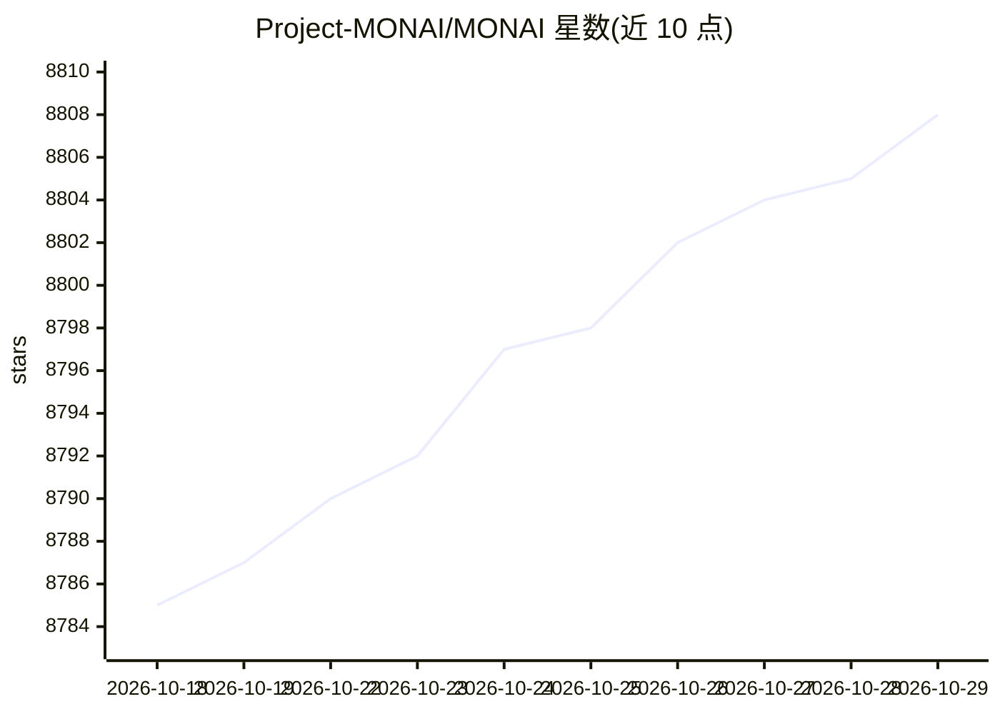

# Project-MONAI/MONAI

⭐ 8,808 · Python · Apache-2.0 · 推送 2026-10-28 · [GitHub](https://github.com/Project-MONAI/MONAI) · [官网](https://project-monai.github.io/) · 组织维护

**面向医疗影像的 PyTorch 深度学习框架**

MONAI 是基于 PyTorch 的医疗影像深度学习开源框架，隶属 PyTorch Ecosystem。提供多维医疗影像数据的预处理、可组合可移植的 API、领域专用的网络/损失函数/评估指标实现，支持多 GPU 多节点数据并行训练。依赖 NumPy 与 PyTorch（其余多为可选依赖），支持当前版本及往前三个 minor 版本的 PyTorch。通过 pip 安装，提供 Docker 镜像、Model Zoo 模型共享与 Bundle 格式，面向学术、工业与临床研究人员。

## 筛选速览

| 维度 | 判定 | 备注 |
|---|---|---|
| AI 角色 | `ai-native` | 本体是模型或模型工具 |
| 许可风险 | `permissive` | Apache-2.0 |
| 部署形态 | `self-host` | docker 或自建部署 |
| 模型依赖 | — | README 未给出锁定关系 |
| 硬件要求 | — | 无带数字的原话,不猜 |
| 安装摩擦 | `low` | 无编译、无系统依赖或容器化 |
| 成熟度 | — | 结构信号不足 |

## 能力要点

- 多维医疗影像数据的灵活预处理
- 领域专用的网络、损失函数与评估指标实现
- 多 GPU 多节点数据并行训练支持
- Model Zoo 以 Bundle 格式共享社区模型

## 适用场景

- 我在医疗影像数据上训练和评估深度学习模型
- 我把医疗影像处理流程集成到现有 PyTorch 工作流中
- 我需要多 GPU 多节点的大规模影像训练

## 场景标签

 · 领域:医疗影像/深度学习

## 证据(README 行号)

> L18: MONAI is a PyTorch-based, open-source framework for deep learning in healthcare imaging, part of the PyTorch Ecosys
> L29: - flexible pre-processing for multi-dimensional medical imaging data;
> L31: - domain-specific implementations for networks, losses, evaluation metrics and more;

## 星数曲线

2026-10-18 8,785 → 2026-10-29 8,808（+23）

---
*卡片 v1 · prompt 1.4 · 生成 2026-10-20 · 置信度 high · 依据 README sha `5a8b241b96e1` · [字段定义](../../DATASET.md)*
