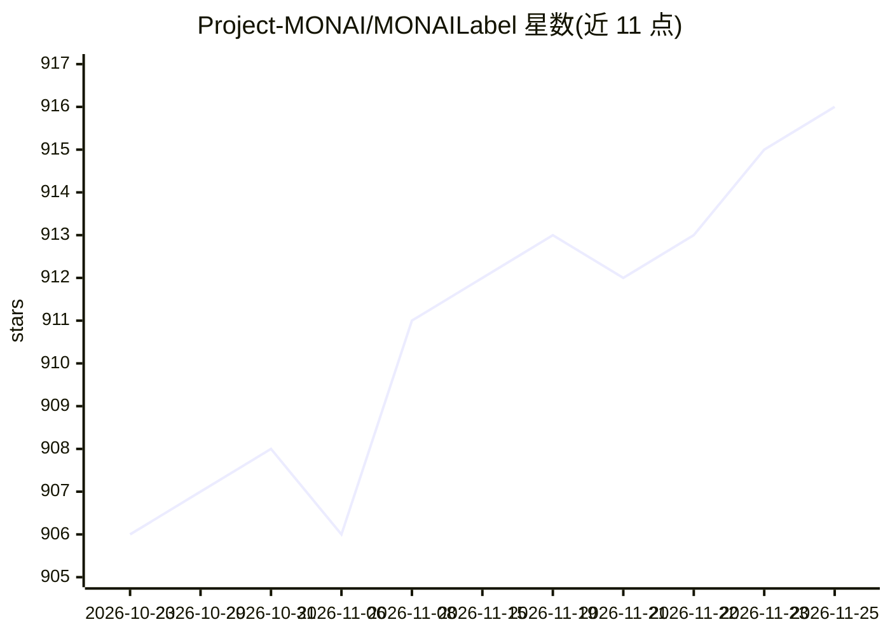

# Project-MONAI/MONAILabel

⭐ 916 · Python · Apache-2.0 · 推送 2026-11-22 · [GitHub](https://github.com/Project-MONAI/MONAILabel) · [官网](https://monai.readthedocs.io/projects/label/en/latest/) · 组织维护

**医学影像 AI 辅助标注服务器：交互式标注并持续学习**

MONAI Label 是服务器-客户端架构的医学影像标注与学习工具：开发者以 serverless 方式编写标注应用并通过 MONAI Label Server 暴露服务，终端用户（临床医生、技师、标注员）通过 3D Slicer、OHIF、QuPath、CVAT 等查看器交互式标注，模型随用户交互持续学习（主动学习）。支持放射、病理、内窥镜视频三类场景，集成 Model-Zoo 中的 SOTA 模型（UNet/UNETR/SAM2 等），经 DICOMWeb 连接 PACS。安全公告要求仅部署于可信局域网。

## 筛选速览

| 维度 | 判定 | 备注 |
|---|---|---|
| AI 角色 | `ai-native` | 本体是模型或模型工具 |
| 许可风险 | `permissive` | Apache-2.0 |
| 部署形态 | `self-host` | docker 或自建部署 |
| 模型依赖 | — | README 未给出锁定关系 |
| 硬件要求 | — | 无带数字的原话,不猜 |
| 安装摩擦 | `low` | 无编译、无系统依赖或容器化 |
| 成熟度 | — | 结构信号不足 |

## 能力要点

- 框架支持开发与部署标注应用，模型随用户交互持续学习
- 支持 3D Slicer/OHIF/MITK/QuPath/Digital Slide Archive/CVAT 等查看器集成
- 通过 DICOMWeb 连接 PACS，支持本地数据存储
- Model-Zoo 集成 SOTA 模型：全身/全脑分割、肺结节检测、SAM2 交互分割

## 适用场景

- 用 3D Slicer 对 CT/MRI 做交互式器官分割标注
- 病理 WSI 图像的细胞核分割与分类标注
- 结合 CVAT 对内窥镜视频做自动主动学习训练
- 基于 Model-Zoo bundle 定制解剖结构的推理与训练

## 场景标签

`目标检测` · 领域:感知与多模态

## 证据(README 行号)

> L10: MONAI Label is an intelligent open source image labeling and learning tool that enables users to create annotated d
> L12: MONAI Label is a server-client system that facilitates interactive medical image annotation by using AI. It is an
> L37: - Framework for developing and deploying MONAI Label Apps to train and infer AI models

## 星数曲线

2026-10-23 906 → 2026-11-25 916（+10）

---
*卡片 v1 · prompt 1.4 · 生成 2026-11-25 · 置信度 high · 依据 README sha `6bee679668cc` · [字段定义](../../DATASET.md)*
