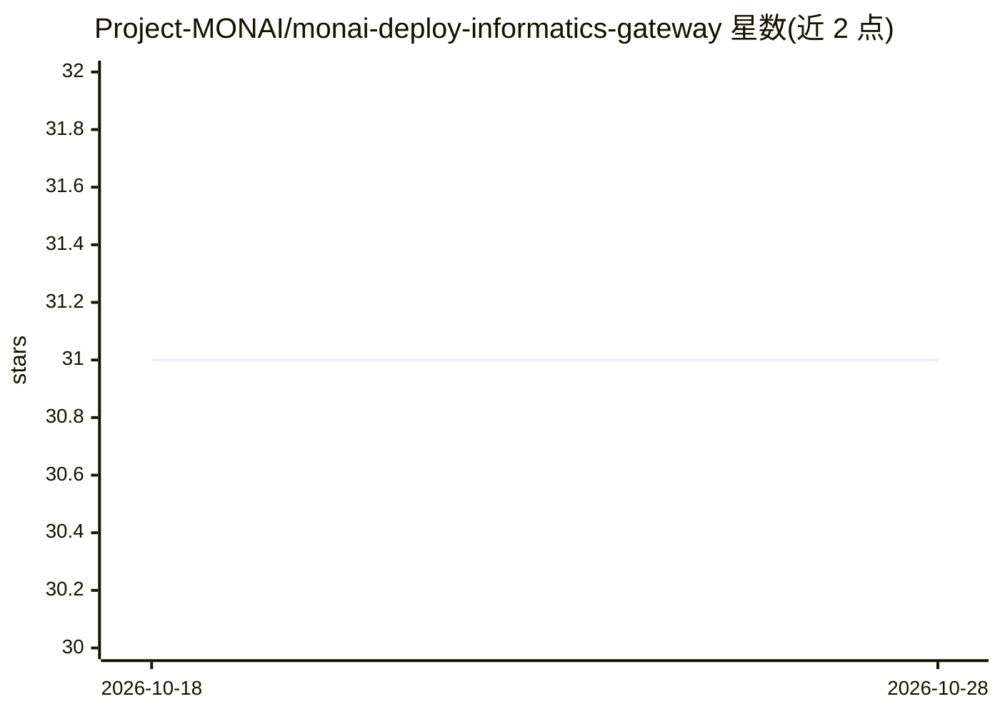

# Project-MONAI/monai-deploy-informatics-gateway

⭐ 31 · C# · Apache-2.0 · 推送 2026-03-05 · [GitHub](https://github.com/Project-MONAI/monai-deploy-informatics-gateway) · [官网](https://project-monai.github.io/monai-deploy-informatics-gateway/) · 组织维护

**临床影像数据管线的 DICOM/FHIR 输入输出网关**

MONAI Deploy Informatics Gateway（MIG）处理临床数据管线中的第一和最后一步：输入与输出。通过 DICOM、DICOMweb、FHIR 等标准协议从医疗记录系统接收影像与资源并存储为载荷，随后通知 MONAI Deploy Workflow Manager 数据就绪可处理；推理完成后，MIG 接收通知并将结果导出到 PACS、可视化查看器、VNA 或 EHR 等下游系统。面向参与 MONAI Deploy 部署的开发者与医院信息系统集成场景，运行依赖 Docker，开发需 .NET 6 SDK，安装细节指向用户指南。

## 筛选速览

| 维度 | 判定 | 备注 |
|---|---|---|
| AI 角色 | `ai-ecosystem` | LLM/agent 周边工具 |
| 许可风险 | `permissive` | Apache-2.0 |
| 部署形态 | `None` |  |
| 模型依赖 | — | README 未给出锁定关系 |
| 硬件要求 | — | 无带数字的原话,不猜 |
| 安装摩擦 | `medium` | 含编译或系统依赖之一 |
| 成熟度 | — | 结构信号不足 |

## 能力要点

- 通过 DICOM 与 FHIR 标准协议接收并存储医疗影像与资源
- 数据就绪后通知 MONAI Deploy Workflow Manager 触发处理
- 推理结果导出到 PACS、查看器、VNA、EHR 等下游系统

## 适用场景

- 把 MONAI Deploy 推理管线接入医院 DICOM/PACS 系统
- 从影像系统（PACS/EMR）采集数据并触发医学 AI 工作流
- 将推理结果按标准协议推送回临床系统

## 场景标签

 · 领域:医疗影像/医学IT集成

## 证据(README 行号)

> L11: MONAI Deploy Informatics Gateway (MIG) handles the first and last step in a clinical data pipeline, the Input, and 
> L13: MIG uses standard protocols like DICOM and FHIR. It stores studies and resources from the medical record system as 
> L15: After inference completes, MIG receives notifications for exporting the results to the proper consumers, usually PA

## 星数曲线

2026-10-18 31 → 2026-10-28 31（+0）

---
*卡片 v1 · prompt 1.4 · 生成 2026-10-26 · 置信度 high · 依据 README sha `82122a0b0774` · [字段定义](../../DATASET.md)*
