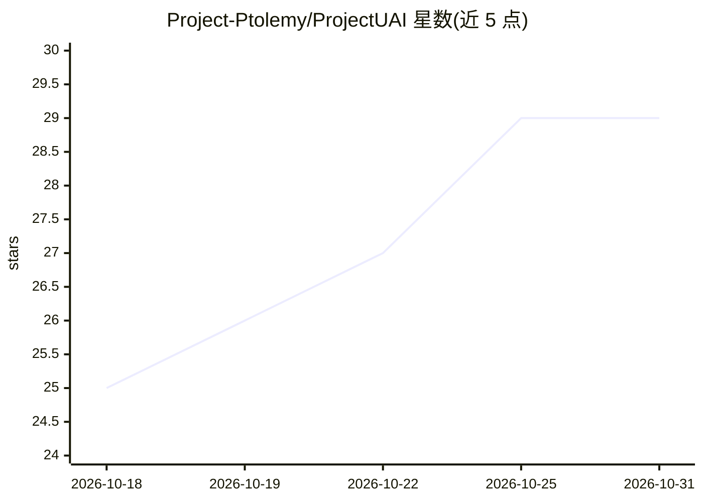

# Project-Ptolemy/ProjectUAI

⭐ 29 · Lua · MIT · 推送 2026-10-30 · [GitHub](https://github.com/Project-Ptolemy/ProjectUAI) · [官网](https://project-ptolemy.github.io/ProjectUAI/) · 组织维护

**在 Roblox 客户端内运行的通用 AI agent，Claude Code 式 agent 循环**

以 Lua 脚本（loadstring 加载）嵌入 Roblox 客户端的通用 AI agent：提供流式输出、并行工具调用、带退避的重试、provider 回退、上下文自动压缩、权限门控、持久记忆、并发子 agent 与请求日志的 agent 循环；通过原生工具让模型检查与自动化 Roblox 环境。支持任意 OpenAI 兼容、OpenAI Responses 与 Anthropic Messages 端点，含本地服务器与中继。配套 Windows 桥接程序、Web UI、Android 伴侣应用与自有 UI 库、嵌入 SDK。含免费的 Project UAI Free 默认路由。

## 筛选速览

| 维度 | 判定 | 备注 |
|---|---|---|
| AI 角色 | `ai-native` | 本体是模型或模型工具 |
| 许可风险 | `permissive` | MIT |
| 部署形态 | `desktop` | 安装包/桌面程序 |
| 模型依赖 | local-ok | 支持本地模型 |
| 硬件要求 | — | 无带数字的原话,不猜 |
| 安装摩擦 | `low` | 无编译、无系统依赖或容器化 |
| 成熟度 | — | 结构信号不足 |

## 能力要点

- 在 Roblox 客户端内运行的 agent 循环（流式、并行工具调用、重试回退、上下文压缩）
- 接入任意 OpenAI 兼容 / Responses / Anthropic Messages 端点，含本地服务器与中继
- 自带 UI 库与嵌入 SDK 1.0.0，可无 UI 集成到宿主脚本
- 多 API key 管理、免费默认路由与 Tor 配额恢复等机制

## 适用场景

- 在任意 Roblox 游戏中用 AI agent 检查与自动化操作环境
- 通过 Roblox 内对话让模型执行原生工具与脚本任务
- 接入自选 provider（含本地推理服务器）在客户端内使用 agent

## 场景标签

`编码 Agent` `Agent 框架` · 领域:Agent 开发

## 证据(README 行号)

> L3: A universal AI agent that runs inside a Roblox client. It works in any game,
> L4: with Chat Completions, OpenAI Responses and Anthropic Messages endpoints,
> L173: **A real agent loop.** Streaming, parallel tool calls, retry with backoff that

## 星数曲线

2026-10-18 25 → 2026-10-31 29（+4）

---
*卡片 v1 · prompt 1.4 · 生成 2026-10-26 · 置信度 high · 依据 README sha `d63bdb391a7e` · [字段定义](../../DATASET.md)*
