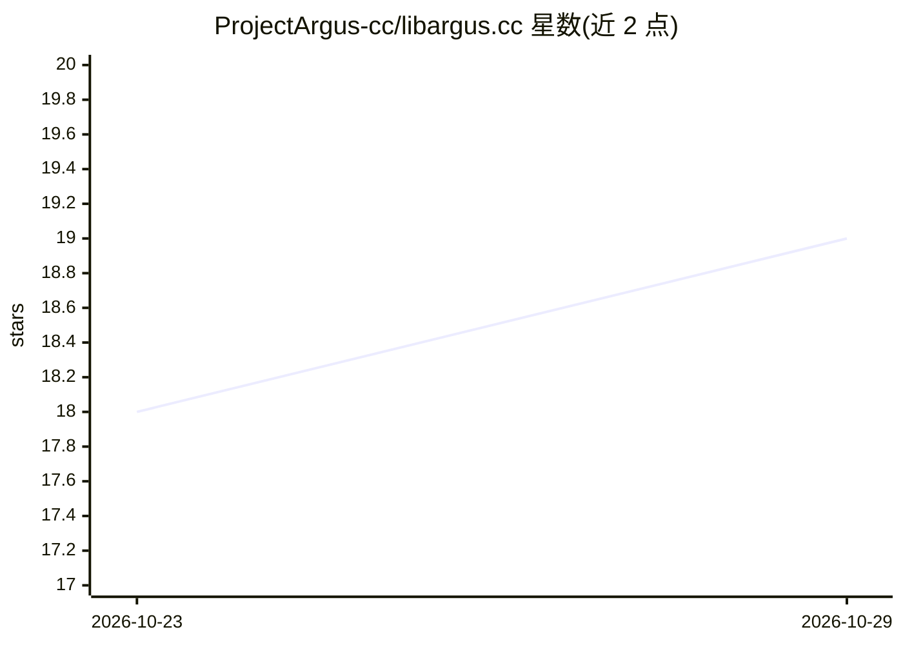

# ProjectArgus-cc/libargus.cc

⭐ 19 · Java · MIT · 推送 2026-10-25 · [GitHub](https://github.com/ProjectArgus-cc/libargus.cc) · [官网](https://projectargus.cc) · 组织维护

**Java/Android/C++ 进程内本地多模态 AI 推理运行时**

基于 llama.cpp、GGML 与 whisper.cpp 构建的原生推理运行时，提供严格线程安全的 C ABI 与两套 Java 绑定：面向 JDK 22+ 的 Panama FFM 版、面向 JDK 17+/Android 的 JNI 版，另含 LangChain4j 集成模块。支持进程内运行 GGUF 语言模型、语义嵌入、多模态视觉/视频、Whisper 语音转文字与语音合成。通过 Maven Central 发布，并提供 Linux/Windows/macOS 多硬件（CPU/CUDA/ROCm/Vulkan/Metal）预编译本地库；也可 CMake 从源码构建。限制：FFM 版需 JVM 标志 --enable-native-access=ALL-UNNAMED。

## 筛选速览

| 维度 | 判定 | 备注 |
|---|---|---|
| AI 角色 | `ai-ecosystem` | LLM/agent 周边工具 |
| 许可风险 | `permissive` | MIT |
| 部署形态 | `None` |  |
| 模型依赖 | — | README 未给出锁定关系 |
| 硬件要求 | — | 无带数字的原话,不猜 |
| 安装摩擦 | `high` | 编译与系统依赖俱全 |
| 成熟度 | — | 结构信号不足 |

## 能力要点

- 进程内运行 GGUF LLM、嵌入、视觉/视频、Whisper ASR、TTS，无需独立 Python 服务
- 双 Java 绑定：JDK 22+ Panama FFM 与 JDK 17+/Android JNI，源码级兼容
- LangChain4j 集成：ChatModel/StreamingChatModel/EmbeddingModel/TokenCountEstimator
- 8 种硬件目标预编译原生库（CPU/CUDA/ROCm/Vulkan/Metal）

## 适用场景

- 在 Java 服务或 Android 应用中本地运行 GGUF 模型，避免外部推理服务
- 用 LangChain4j 构建零 sidecar 的本地 RAG 与多模态应用
- 桌面/服务器 JVM 上做低延迟本地推理与嵌入式语音转录

## 场景标签

`推理引擎` `语音识别` `语音合成` `多模态` · 领域:内容生成

## 证据(README 行号)

> L3: Run GGUF language models, generate embeddings, process images and video, transcribe audio, and synthesize speech fro
> L13: libargus is a high-performance native inference runtime built on established engines including `llama.cpp`, GGML, a
> L23: Built directly on top of **GGML**, **llama.cpp (`libmtmd`)**, and **whisper.cpp**, `libargus` provides a strict, th

## 星数曲线

2026-10-23 18 → 2026-10-29 19（+1）

---
*卡片 v1 · prompt 1.4 · 生成 2026-10-28 · 置信度 high · 依据 README sha `5574e27dd8ab` · [字段定义](../../DATASET.md)*
