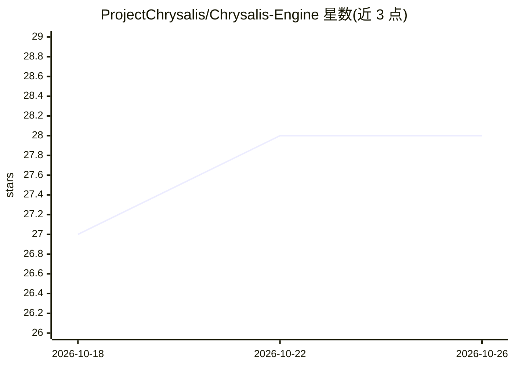

# ProjectChrysalis/Chrysalis-Engine

⭐ 28 · TypeScript · AGPL-3.0 · 推送 2026-10-24 · [GitHub](https://github.com/ProjectChrysalis/Chrysalis-Engine) · [官网](https://projectchrysalis.github.io) · 组织维护

**可通过对话改造的自托管 AI 前端：内置 agent 修改应用**

运行在用户自己电脑或手机上、浏览器打开的 AI 前端：从内置 Store 选取应用，应用以普通文件形式存在，内置 agent 可在用户观看时修改这些文件并按请求构建功能；聊天、角色与密钥存储在本地设备。支持在标签页中运行 SillyTavern、Marinara 等服务应用（需 1.0.4+，程序启动需管理员批准），用户在设置中添加自己的模型 API 连接。提供多平台安装包、Docker、npm（Bun）与源码运行方式；工作区为 git 管理的文件目录，也可用外部编码工具编辑。macOS 构建未签名，需经 start.command 启动。

## 筛选速览

| 维度 | 判定 | 备注 |
|---|---|---|
| AI 角色 | `ai-native` | 本体是模型或模型工具 |
| 许可风险 | `viral` | AGPL-3.0 |
| 部署形态 | `desktop` | 安装包/桌面程序 |
| 模型依赖 | — | README 未给出锁定关系 |
| 硬件要求 | — | 无带数字的原话,不猜 |
| 安装摩擦 | `low` | 无编译、无系统依赖或容器化 |
| 成熟度 | — | 结构信号不足 |

## 能力要点

- 内置 agent 可在用户观看时实时修改与构建应用文件
- 支持以标签页运行 SillyTavern / Marinara 并通过其 API 编辑角色、lorebook 等数据
- 数据（聊天、角色、密钥）存储在用户设备，工作区为 git 管理的普通文件目录
- 提供 Windows/macOS/Linux/Android 安装包、Docker 镜像与 Bun 全局安装多种方式

## 适用场景

- 在自己设备上自托管一个可让 AI 改造功能的聊天前端
- 让 agent 通过对话创建或修改角色、聊天与应用设置
- 用外部编辑器或编码 agent 直接编辑 Chrysalis 工作区文件

## 场景标签

`聊天机器人` `编码 Agent` · 领域:编码与开发

## 证据(README 行号)

> L12: **The AI frontend you can reshape just by asking.**
> L16: built-in agent can change while you watch. Ask for a feature and it builds it.
> L75: Open it, create your account, and add a model connection in

## 星数曲线

2026-10-18 27 → 2026-10-26 28（+1）

---
*卡片 v1 · prompt 1.4 · 生成 2026-10-26 · 置信度 high · 依据 README sha `75a6eec224c1` · [字段定义](../../DATASET.md)*
