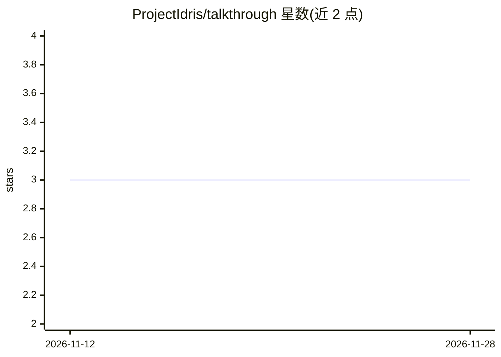

# ProjectIdris/talkthrough

⭐ 3 · TypeScript · MIT · 推送 2026-11-22 · [GitHub](https://github.com/ProjectIdris/talkthrough) · 个人维护

**屏幕内容讲解助手：语音加图示与3D模型覆盖页面**

一款 Electron 桌面应用：用户按住热键提问，模型读取屏幕截图后在页面上叠加解释——绘制标注框、箭头、流程图，并可渲染带联动机构的三维模型（差速器、齿轮组、锁具等），同步语音与字幕播讲。支持四种模型接入路线：Codex CLI、Claude Code、OpenAI API key 或本地 OpenAI 兼容视觉模型。含引导模式（标记点击位置、核对屏幕变化）。仅支持 Windows 11，安装包未签名，构建需 Node.js 24+。

## 筛选速览

| 维度 | 判定 | 备注 |
|---|---|---|
| AI 角色 | `ai-native` | 本体是模型或模型工具 |
| 许可风险 | `permissive` | MIT |
| 部署形态 | `desktop` | 安装包/桌面程序 |
| 模型依赖 | local-ok | 支持本地模型 |
| 硬件要求 | — | 无带数字的原话,不猜 |
| 安装摩擦 | `low` | 无编译、无系统依赖或容器化 |
| 成熟度 | — | 结构信号不足 |

## 能力要点

- 提问后在原页面上叠加标注、图表与可交互 3D 模型
- 四种模型路线：Codex CLI、Claude Code、OpenAI API key、本地 OpenAI 兼容模型
- 引导模式标记点击位置并核对屏幕变化，不代用户点击
- 内置四个离线示例，无需账号、麦克风或屏幕捕获

## 适用场景

- 看技术文档时对着屏幕提问并获得带图示的讲解
- 学习机械结构时查看可拆解、联动的 3D 模型
- 在应用中跟随引导模式完成界面操作步骤

## 场景标签

`AI 助手` `多模态` · 领域:对话与助手

## 证据(README 行号)

> L3: **Ask about what is on your screen. Get a spoken or written explanation with marks, diagrams, or a 3D model over the
> L53: Talkthrough supports four model routes: your **Codex CLI**, **Claude Code**, an **OpenAI API key**, or a **local Op
> L65: Talkthrough 1.0 is Windows only, and unsigned (see above). Mouse circling, model dragging and guide navigation are 

## 星数曲线

2026-11-12 3 → 2026-11-28 3（+0）

---
*卡片 v1 · prompt 1.4 · 生成 2026-11-22 · 置信度 high · 依据 README sha `d28e882510d8` · [字段定义](../../DATASET.md)*
