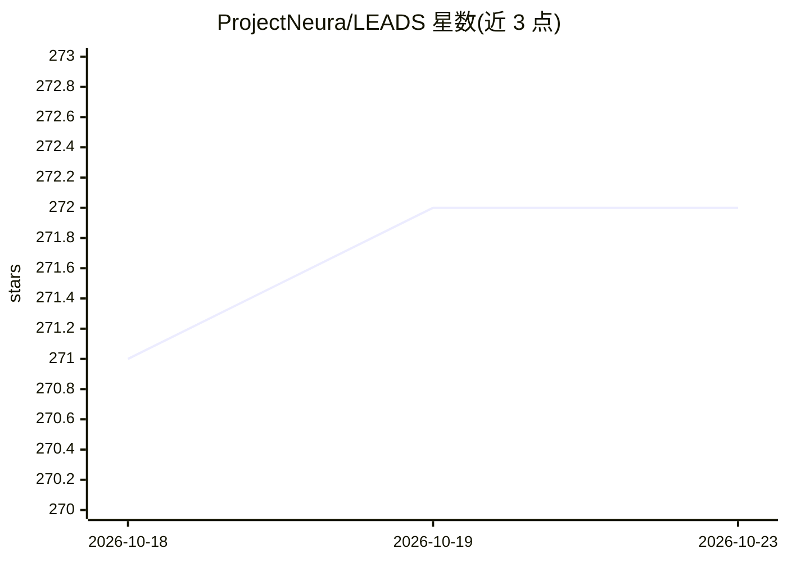

# ProjectNeura/LEADS

⭐ 272 · Python · Apache-2.0 · 推送 2026-07-09 · [GitHub](https://github.com/ProjectNeura/LEADS) · [官网](https://leads.projectneura.org) · 组织维护

**面向赛车的轻量嵌入式辅助驾驶系统：仪表、控制与数据分析**

用 Python 与 C/C++ 编写的嵌入式辅助驾驶系统，面向赛车开发者的仪表、控制与分析需求。LEADS 框架提供与车辆交互的上下文、设备树、TCP 通信、GUI 等抽象层；LEADS VeC 为可执行模块集，可经 JSON 配置或自定义代码组装。内置 4 套 ESC 系统（DTCS/ABS/EBI/ATBS）插件、数据持久化（CSV）、实时视频流与 Remote Analyst 远程分析端。硬件面向 Raspberry Pi/Arduino 等通用开发板，需 Python>=3.12，AI 相关能力体现为对视觉输入的支持与基于数据的 AI 增强分析方向。

## 筛选速览

| 维度 | 判定 | 备注 |
|---|---|---|
| AI 角色 | `ai-enhanced` | 去掉 AI 部分产品仍成立 |
| 许可风险 | `permissive` | Apache-2.0 |
| 部署形态 | `library` | 以包/库形式分发 |
| 模型依赖 | — | README 未给出锁定关系 |
| 硬件要求 | — | 无带数字的原话,不猜 |
| 安装摩擦 | `low` | 无编译、无系统依赖或容器化 |
| 成熟度 | — | 结构信号不足 |

## 能力要点

- 4 套 ESC 插件（DTCS/ABS/EBI/ATBS），各含 4 档标定与手动模式
- TCP 数据链路：车辆作服务器，数据分发至维修区并持久化为 CSV
- 低延迟多摄像头视频编码与流式传输
- 多显示器支持与数据回放（replay）、基准测试（benchmark）

## 适用场景

- 为电动赛车搭建车载仪表与电控系统
- 维修区实时远程监控车辆状态
- 录制数据后回放分析圈速与驾驶行为
- 基于框架抽象层定制自己的车载项目

## 场景标签

`数据分析` · 领域:效率与自动化

## 证据(README 行号)

> L149: As an organization that is deeply rooted in AI, visual data has special meaning to us. In LEADS, we value visual i
> L151: suitable for AI applications.
> L174:  AI-enhanced data analysis and driver training

## 星数曲线

2026-10-18 271 → 2026-10-23 272（+1）

---
*卡片 v1 · prompt 1.4 · 生成 2026-10-22 · 置信度 high · 依据 README sha `d55ac4838708` · [字段定义](../../DATASET.md)*
