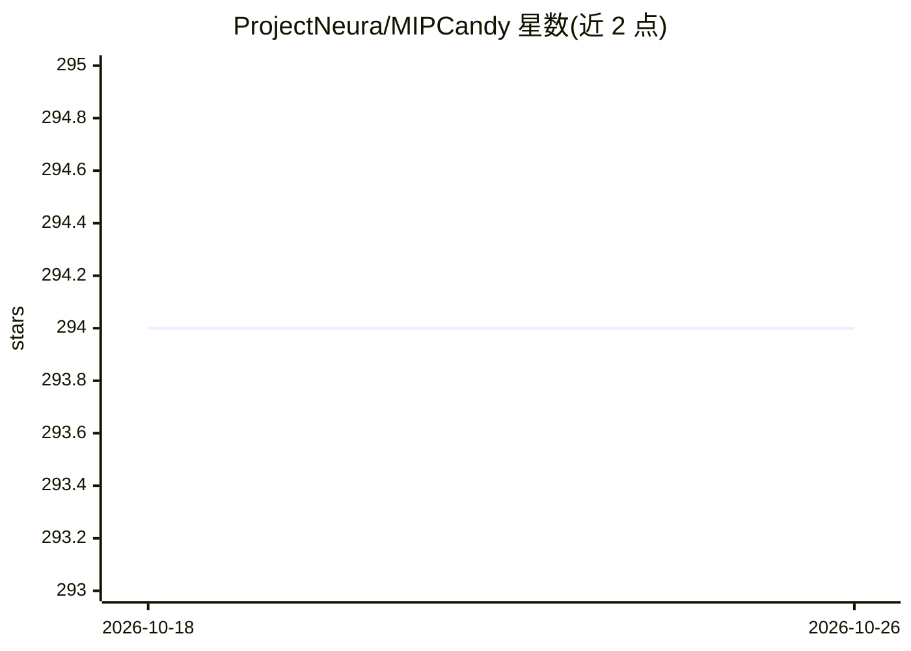

# ProjectNeura/MIPCandy

⭐ 294 · Python · Apache-2.0 · 推送 2026-07-09 · [GitHub](https://github.com/ProjectNeura/MIPCandy) · [官网](https://mipcandy.projectneura.org) · 组织维护

**医学图像处理 PyTorch 实验流水线框架，训练/推理/评测开箱即用**

Project Neura 维护的医学图像处理基础设施框架：预定义常见网络架构及配套的训练、推理、评测流水线，研究者可快速搭建完整实验流程并聚焦实验设计本身。基于 PyTorch，要求 Python >= 3.12，通过 pip 安装；另集成 Notion、WandB、TensorBoard 等前端看板。附带 ACDC 数据集示例，README 称该示例复现 nnU-Net 的大部分特性（不含数据增强）。有出版物可引用。

## 筛选速览

| 维度 | 判定 | 备注 |
|---|---|---|
| AI 角色 | `ai-ecosystem` | LLM/agent 周边工具 |
| 许可风险 | `permissive` | Apache-2.0 |
| 部署形态 | `library` | 以包/库形式分发 |
| 模型依赖 | — | README 未给出锁定关系 |
| 硬件要求 | — | 无带数字的原话,不猜 |
| 安装摩擦 | `low` | 无编译、无系统依赖或容器化 |
| 成熟度 | — | 结构信号不足 |

## 能力要点

- 预定义网络架构及训练/推理/评测流水线，开箱即用
- 集成 Notion、WandB、TensorBoard 看板
- ACDC 数据集示例复现 nnU-Net 大部分特性（不含增强）

## 适用场景

- 医学图像（CT/MRI）分割、分类、检测的快速原型实验
- 接入 WandB/TensorBoard 跟踪训练过程

## 场景标签

`MLOps` · 领域:训练与推理

## 证据(README 行号)

> L10: MIP Candy is Project Neura's next-generation infrastructure framework for medical image processing. It defines a ha
> L11: of common network architectures with their corresponding training, inference, and evaluation pipelines that are

## 星数曲线

2026-10-18 294 → 2026-10-26 294（+0）

---
*卡片 v1 · prompt 1.4 · 生成 2026-10-21 · 置信度 mid · 依据 README sha `636983f6f744` · [字段定义](../../DATASET.md)*
