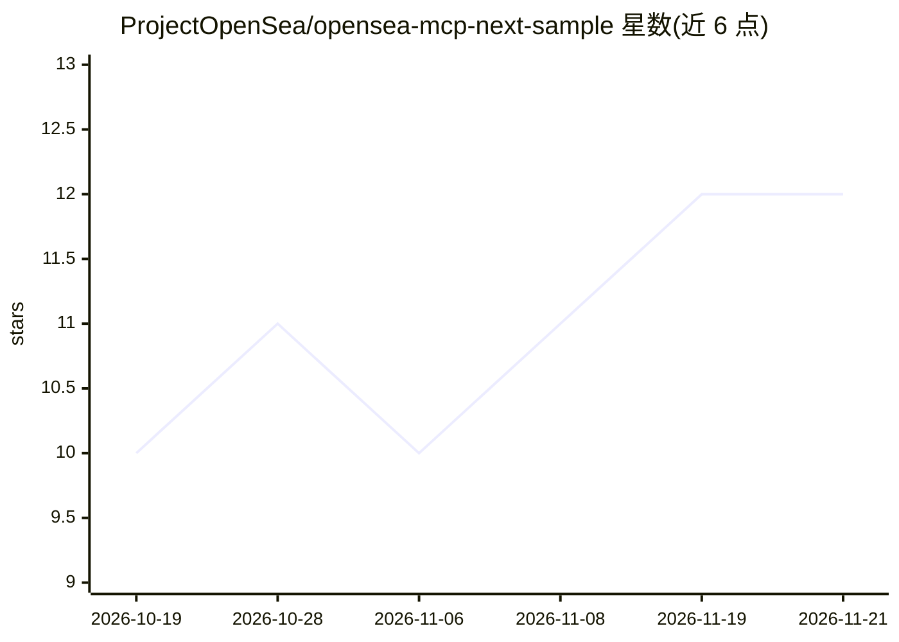

# ProjectOpenSea/opensea-mcp-next-sample

⭐ 12 · TypeScript · MIT · 推送 2026-02-07 · [GitHub](https://github.com/ProjectOpenSea/opensea-mcp-next-sample) · 组织维护

**连接 OpenSea MCP 服务构建 NFT 市场问答应用的 Next.js 示例**

官方提供的最小化示例应用：用 Next.js 与 Vercel AI SDK 连接 OpenSea 托管的 MCP 服务器，通过 SSE 建立客户端，动态获取工具列表并交由支持 tool calling 的模型调用，从而对 NFT 集合、代币数据、钱包余额、兑换报价、趋势分析等市场数据执行搜索、分析与操作。前端使用 useChat 展示对话与工具调用 I/O。运行需 Node 18+、pnpm/npm，以及 OpenAI API key 与 OpenSea MCP 访问令牌两个环境变量。

## 筛选速览

| 维度 | 判定 | 备注 |
|---|---|---|
| AI 角色 | `ai-native` | 本体是模型或模型工具 |
| 许可风险 | `permissive` | MIT |
| 部署形态 | `library` | 以包/库形式分发 |
| 模型依赖 | — | README 未给出锁定关系 |
| 硬件要求 | — | 无带数字的原话,不猜 |
| 安装摩擦 | `low` | 无编译、无系统依赖或容器化 |
| 成熟度 | — | 结构信号不足 |

## 能力要点

- 通过 SSE 连接 mcp.opensea.io 并动态获取工具列表转发给模型
- useChat 对话界面与结构化工具调用检查器
- 支持查询多链数据（Ethereum/Base/Polygon/Solana）
- 兼容任何支持 tool calling 的模型，示例推荐 Claude Sonnet 4 或 GPT-5

## 适用场景

- 查询 NFT 集合趋势、地板价与 24 小时成交量
- 获取 ETH 兑换 USDC 的 swap 报价
- 查看指定钱包的 NFT 持仓
- 作为接入 OpenSea MCP 的起点改造自己的应用

## 场景标签

`聊天机器人` · 领域:对话与助手

## 证据(README 行号)

> L5: This is a minimal Next.js app showing how to connect the OpenSea MCP server to the Vercel AI SDK to build an AI expe
> L16: OpenSea MCP is a hosted server that exposes tools for AI agents to access NFT collections, items, token data, walle

## 星数曲线

2026-10-19 10 → 2026-11-21 12（+2）

---
*卡片 v1 · prompt 1.4 · 生成 2026-11-18 · 置信度 high · 依据 README sha `4f3e4977a30d` · [字段定义](../../DATASET.md)*
