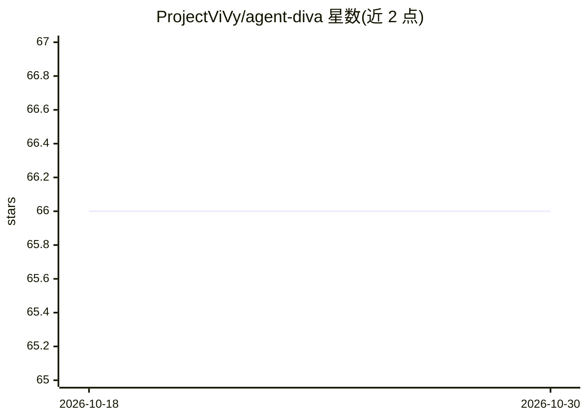

# ProjectViVy/agent-diva

⭐ 66 · TypeScript · MIT · 推送 2026-10-11 · [GitHub](https://github.com/ProjectViVy/agent-diva) · [官网](https://projectvivy.github.io/agent-diva-docs/) · 组织维护 · 中文 README

**自托管个人 AI 网关：把聊天应用接入 LLM 助手，Rust 实现**

Rust 编写的多 crate 个人 AI 助手框架：Gateway 进程作为聊天平台（Telegram/Discord/QQ/钉钉/飞书/Email）与 45+ Provider 预设之间的桥接，内含 Agent 循环、SQLite+FTS5 分层记忆、Laputa 人格治理层、AutoDream 提案蒸馏、SKILL.md 技能市场、沙箱与人审（HITL）批准中心、cron 定时任务，提供 CLI/TUI/Tauri GUI 三套界面，从源码编译安装（Rust 1.80+，GUI 需 Node.js 18+）。面向开发者、power user 与实验者。注意：当前分支已移除 Rust 工作区与 Tauri 后端，仅剩 Vue 前端待接 VIVY 后端；文档移至 dev 分支。

## 筛选速览

| 维度 | 判定 | 备注 |
|---|---|---|
| AI 角色 | `ai-native` | 本体是模型或模型工具 |
| 许可风险 | `permissive` | MIT |
| 部署形态 | `library` | 以包/库形式分发 |
| 模型依赖 | local-ok | 支持本地模型 |
| 硬件要求 | — | 无带数字的原话,不猜 |
| 安装摩擦 | `low` | 无编译、无系统依赖或容器化 |
| 成熟度 | — | 结构信号不足 |

## 能力要点

- 多渠道网关默认启用 Telegram/Discord/QQ/钉钉/飞书/Email，另有多渠道 opt-in 特性
- 45+ Provider 预设含 Ollama 本地与自定义 OpenAI 兼容端点
- BML（SQLite+FTS5）记忆 + Laputa 治理层（提案/回滚/审计/Frozen Core）
- 沙箱策略与 CLI/GUI 审批中心实现 human-in-the-loop

## 适用场景

- 在自己的服务器上跑一个把 Telegram/QQ 等聊天接入 LLM 的常驻助手
- 通过 GUI 审阅 AutoDream 生成的人格演化提案并治理记忆
- 用 cron 定时任务驱动 agent 并投递到指定渠道

## 场景标签

`AI 助手` `Agent 记忆` · 领域:Agent 开发

## 证据(README 行号)

> L22: Agent Diva is a **self-hosted personal AI gateway** that connects your
> L25: becomes the bridge between chat platforms and LLMs — with durable memory,
> L62: - **45+ built-in provider presets** — OpenRouter, DeepSeek, OpenAI,

## 星数曲线

2026-10-18 66 → 2026-10-30 66（+0）

---
*卡片 v1 · prompt 1.4 · 生成 2026-10-24 · 置信度 mid · 依据 README sha `0e2c4951df02` · [字段定义](../../DATASET.md)*
