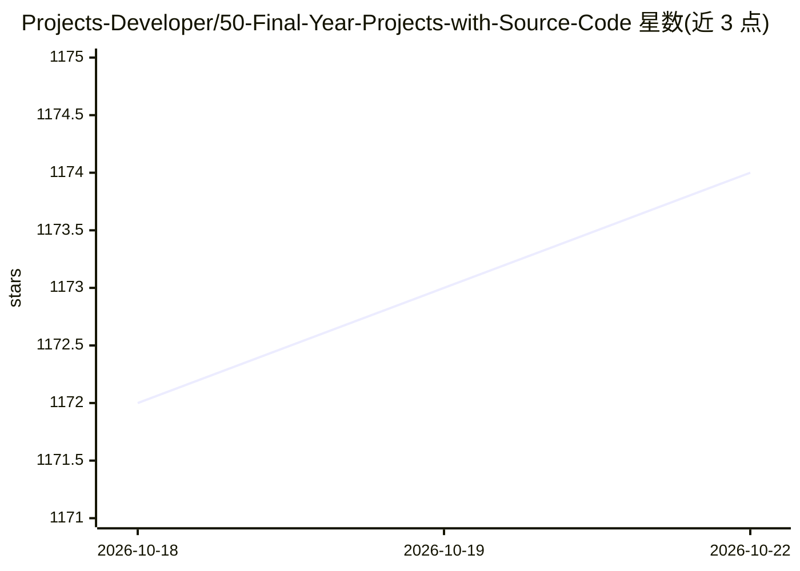

# Projects-Developer/50-Final-Year-Projects-with-Source-Code

⭐ 1,174 · 推送 2026-01-22 · [GitHub](https://github.com/Projects-Developer/50-Final-Year-Projects-with-Source-Code) · [官网](https://www.finalproject.in) · 个人维护

**面向学生的 50 个毕业设计项目合集（源码+文档+视频）**

个人维护的毕业设计项目列表仓库：列出 50 个项目主题，涵盖机器学习/深度学习（恶意软件检测、股价预测、疾病预测、假新闻检测）、区块链（土地登记、投票系统、以太坊浏览器）、密码学（AES、三重 DES、隐写术）与全栈网站等方向。每个条目附 YouTube 演示视频链接；据描述每个项目含源码、PPT、大纲、报告、文档、基础研究论文与视频教程。README 未提供源码安装方式，获取需通过邮件/WhatsApp/网站联系作者。

## 筛选速览

| 维度 | 判定 | 备注 |
|---|---|---|
| AI 角色 | `ai-knowledge` | 知识聚合/清单类 |
| 许可风险 | `none` | — |
| 部署形态 | `None` |  |
| 模型依赖 | — | README 未给出锁定关系 |
| 硬件要求 | — | 无带数字的原话,不猜 |
| 安装摩擦 | `low` | 无编译、无系统依赖或容器化 |
| 成熟度 | — | 结构信号不足 |

## 能力要点

- 50 个项目主题，覆盖 ML/DL、区块链、密码学与 Web 全栈方向
- 每个条目附 YouTube 视频讲解链接
- 据描述配套源码、PPT、报告、研究论文等材料
- 通过邮件/WhatsApp/网站联系获取

## 适用场景

- 寻找毕业设计选题方向与参考实现
- 学习机器学习、区块链项目的完整结构与文档写法
- 观看项目视频讲解了解实现过程

## 场景标签

`精选清单` · 领域:学习与行业

## 证据(README 行号)

> L1: # 50 Final Year Projects with Source Code
> L8: 1. Malware Detection Using Deep Learning :https://youtu.be/f-JRYJWVKKE?si=GuebwSt9chYyjZzT
> L60: ### Project include:

## 星数曲线

2026-10-18 1,172 → 2026-10-22 1,174（+2）

---
*卡片 v1 · prompt 1.4 · 生成 2026-10-21 · 置信度 high · 依据 README sha `08a303f45ba4` · [字段定义](../../DATASET.md)*
