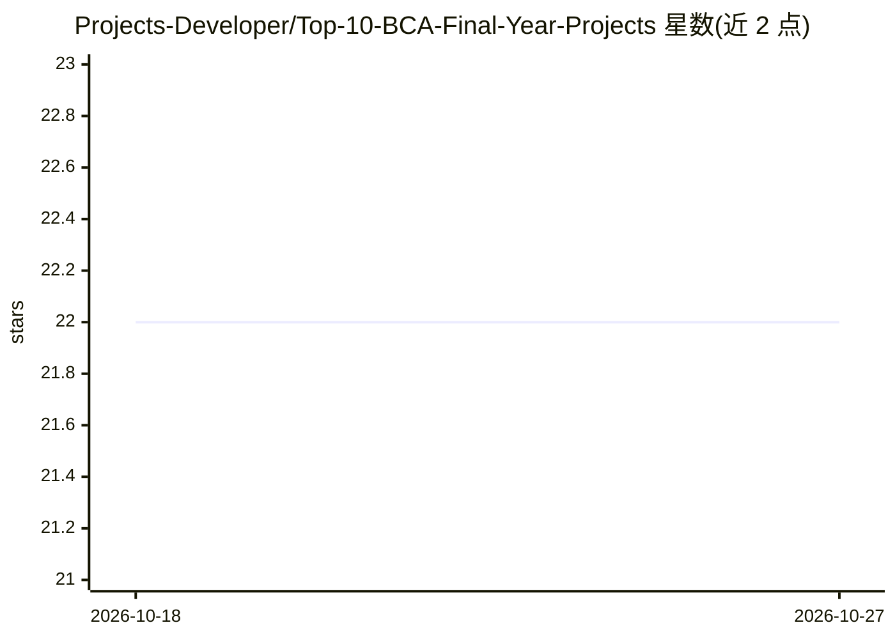

# Projects-Developer/Top-10-BCA-Final-Year-Projects

⭐ 22 · 推送 2026-01-22 · [GitHub](https://github.com/Projects-Developer/Top-10-BCA-Final-Year-Projects) · [官网](https://www.finalproject.in/) · 个人维护

**面向 BCA 毕业生的 10+ 个毕业设计项目合集（含代码/文档/视频）**

汇总约 12 个 BCA/BTech 毕业设计项目主题的策展仓库，条目包括 UPI 欺诈检测、降雨预测、房价预测、AQI 网站、考勤系统、异常检测、URL 钓鱼检测、电商平台、股价预测与聊天机器人等，每条目以 YouTube 视频链接形式给出。仓库声称每套项目包含概要、PPT、研究论文、源码、讲解视频、文档与报告，需要者通过邮件、WhatsApp 或网站联系维护者获取。仓库本身不含源码，仅提供清单与联系方式。

## 筛选速览

| 维度 | 判定 | 备注 |
|---|---|---|
| AI 角色 | `ai-knowledge` | 知识聚合/清单类 |
| 许可风险 | `none` | — |
| 部署形态 | `None` |  |
| 模型依赖 | — | README 未给出锁定关系 |
| 硬件要求 | — | 无带数字的原话,不猜 |
| 安装摩擦 | `low` | 无编译、无系统依赖或容器化 |
| 成熟度 | — | 结构信号不足 |

## 能力要点

- 收录 12 个毕业设计项目主题及对应视频链接
- 声称每套项目含源码、PPT、研究论文、文档与报告
- 提供邮件/WhatsApp/网站等联系获取渠道

## 适用场景

- BCA/BTech 学生寻找毕业设计选题方向
- 通过视频了解各项目功能与实现概览
- 联系维护者获取项目源码与配套文档

## 场景标签

`精选清单` · 领域:学习与行业

## 证据(README 行号)

> L1: # Top 10 BCA Final Year Projects
> L9: 1. UPI Fraud Detection :https://youtu.be/uzVdxlG1gIY?si=0RW3nMAHueOHlsUR
> L21: ### Project include:

## 星数曲线

2026-10-18 22 → 2026-10-27 22（+0）

---
*卡片 v1 · prompt 1.4 · 生成 2026-10-27 · 置信度 high · 依据 README sha `baa4e544120b` · [字段定义](../../DATASET.md)*
